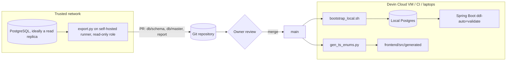

# Database Schema and Master Data as Code

Implementation specification

| Field | Value |
|---|---|
| Status | Draft for review, v1.0 |
| Date | 2026-11-01 |
| Owner | Arun (Engineering Excellence) |
| Repo location | `docs/implementation/db-schema-sync.md` |
| Code location | `db/` (new top-level folder) |
| Used by | Devin Cloud sessions, developers, CI, `docs/implementation/knowledge-hub.md` |

Legend: **[Official]** = vendor tool or documented feature used as designed. **[Custom]** = code written for this project.

---

## 1. Short answer

**Yes. Devin never needs access to PostgreSQL.** A job inside your network exports the schema and the master tables as plain files into the repository. Devin reads those files and builds its own throwaway Postgres inside its VM.

| You asked | Answer | Format | Tool |
|---|---|---|---|
| Export the schema as code? | Yes, in three complementary files | `schema.sql` (restorable DDL), `catalog.json` (structured JSON), `schema.dbml` (readable model) | `pg_dump` [Official], catalog query [Custom], `@dbml/cli db2dbml` [Official] |
| JSON, XML or YAML? | JSON for the structured catalog (YAML adds nothing and XML is verbose for agents). SQL is still required to rebuild a database; no JSON/YAML/XML format can recreate functions, triggers and policies faithfully. | `catalog.json` | Custom query over `pg_catalog` |
| Export master tables, not Excel? | Yes: CSV produced by Postgres `COPY` | `db/master/<schema>.<table>.csv` | `COPY ... TO STDOUT (FORMAT csv, HEADER)` [Official] |
| Can Devin use them? | Yes: load into a local Postgres with `\copy`, generate TypeScript constants from them, read them as context | Same files | `bootstrap_local.sh`, `gen_ts_enums.py` |

Why CSV over JSONL for master data: Postgres reads it back natively with `COPY FROM` (no loader code), it keeps the NULL versus empty-string distinction (unquoted empty field = NULL, `""` = empty string), it handles embedded commas and newlines, and a one-row change shows up as a one-line diff in pull requests. JSONL is a reasonable alternative but needs custom load code; it is not used here.

## 2. Goals and security principles

Goals

- Devin, developers and CI can build an exact local copy of the schema plus reference data with one command.
- Schema and master data changes in the real database become reviewable pull requests every night.
- Application contracts (JPA entities, TypeScript types) are checked against the schema without touching a shared database.

Principles

1. **No credentials or network path to any shared database leave your network.** Only reviewed files in the repository reach Devin.
2. **Read-only and bounded.** The exporter role cannot write; sessions are read-only with a statement timeout and lock wait limit.
3. **Allowlist, not blocklist.** Only tables listed in `export.config.json` are exported as data. Column-level exclusions, a personal-data column name guard, and row/byte limits stop accidental exports of transactional or personal data.
4. **Human review.** Exports arrive as a PR; `CODEOWNERS` on `db/` requires an owner's approval.

## 3. Review of the draft PRD

| # | Draft item | Problem | Resolution |
|---|---|---|---|
| P1 | `iter(lambda: f.read(4096), os.devbytes)` | `os.devbytes` does not exist; the script fails with `AttributeError` on the first hash. | Hashing uses `hashlib.sha256(data)` on bytes already in memory. |
| P2 | DBML diff using a `set()` of lines | Identical lines in different tables collapse (for example `id integer [pk]`), table context is lost, and a type change shows only as an anonymous added/removed line. | Structured diff of `catalog.json` keyed by schema.table.column (Section 6.4). |
| P3 | `sys.exit(1)` before writing the report when extraction fails | The uploaded artifact is missing exactly when it is needed. | Errors raise with a message; the report is written on every completed run. |
| P4 | `npx @dbml/cli db2dbml ...` | `@dbml/cli` ships several binaries (`dbml2sql`, `sql2dbml`, `db2dbml`), so npx needs the package and the binary named separately. | `npx -p @dbml/cli db2dbml ...` (or a pinned devDependency). |
| P5 | `SELECT row_to_json(t) FROM master_x t` without ORDER BY | Row order is not guaranteed, so hashes and diffs change without data changes. | `ORDER BY` primary key (or configured columns) on every export. |
| P6 | Manifest with MD5 and, implicitly, run timestamps | MD5 is a weak choice for integrity; timestamps make every nightly run look like a change. | SHA-256; manifest has no timestamps (run time goes in the report only). |
| P7 | Pipeline compares live DB to repo but never updates the repo | Devin keeps building against stale files until someone edits them by hand. | Exporter writes the files and the pipeline opens or updates a PR. |
| P8 | DBML as the only schema artifact | DBML is a modelling language; it cannot rebuild the database Devin needs (functions, triggers, policies, extension setup). | `schema.sql` from `pg_dump --schema-only` is the restorable artifact; DBML stays for reading. |
| P9 | Plain `pg_dump` output assumed stable | Since the August 2025 security releases (CVE-2025-8714) plain dumps contain `\restrict <key>` and `\unrestrict <key>` lines, with a random key per run unless `--restrict-key` is passed. | Fixed `--restrict-key`, detected automatically; client and server major versions checked. |
| P10 | `runs-on: ubuntu-latest` | GitHub-hosted runners cannot reach an internal database. | Self-hosted runner inside the network for the export job only. |
| P11 | `node-version: '20'` | Node.js 20 reached end of life in April 2026. | Node 24 LTS. |
| P12 | Layers 3 and 4 (Spring Boot and TypeScript contracts) described without implementation | No check would actually run. | Hibernate `ddl-auto=validate` against the bootstrapped DB, OpenAPI type generation, generated master-data constants (Section 9). |
| P13 | No limits or personal-data controls on master exports | One misconfigured table could push customer data into a third-party agent's context. | Allowlist, `excludeColumns`, name-pattern guard requiring explicit `piiReviewed`, row and byte limits. |
| P14 | Emoji in report output | House style. | Plain text. |

## 4. Architecture



## 5. Artifacts

| Path | Content | Produced by | Consumed by |
|---|---|---|---|
| `db/schema/schema.sql` | DDL for the configured schemas: tables, constraints, indexes, views, sequences, functions, triggers, policies, comments. No owners, grants or tablespaces. | `pg_dump --schema-only` [Official] | `bootstrap_local.sh`, Testcontainers tests |
| `db/schema/catalog.json` | Structured, sorted description of every object, used for diffs and as precise agent context | `tools/catalog.sql` [Custom] | `diff.py`, Devin, humans |
| `db/schema/schema.dbml` | Compact readable model, renders on dbdiagram.io | `@dbml/cli db2dbml` [Official] | Devin context, documentation |
| `db/master/<schema>.<table>.csv` | Allowlisted reference data, ordered by key | `COPY` [Official] | `bootstrap_local.sh`, `gen_ts_enums.py` |
| `db/master/manifest.json` | Per table: file, row count, SHA-256, columns and types, order key, classification | `export.py` [Custom] | bootstrap verification, review |
| `db/seed/*.sql` | Synthetic users and records for local runs and the Knowledge Hub personas | Hand-written | `bootstrap_local.sh` |
| `db/config/export.config.json` | What to export and the safety limits | Hand-written, reviewed | `export.py`, `bootstrap_local.sh` |
| `db/out/db_sync_report.md` | Human report of what changed (gitignored) | `export.py` | PR body |

Repository layout:

```text
db/
  config/export.config.json
  schema/schema.sql
  schema/catalog.json
  schema/schema.dbml
  master/<schema>.<table>.csv
  master/manifest.json
  seed/010_personas.sql
  seed/020_kh_fixtures.sql
  tools/catalog.sql
  tools/export.py
  tools/diff.py
  tools/bootstrap_local.sh
  tools/gen_ts_enums.py
  docker-compose.local.yml
  out/                          gitignored
```

## 6. Export (inside the trusted network)

### 6.1 Read-only role

Run once as a DBA. Prefer a read replica so the export never takes locks on the primary. `pg_dump` takes `ACCESS SHARE` locks on each table it dumps, which requires `SELECT`, so the role needs `SELECT` on the exported schemas even for a schema-only dump. Data is still only read for allowlisted tables.

```sql
CREATE ROLE db_exporter LOGIN PASSWORD :'exporter_password'
  NOSUPERUSER NOCREATEDB NOCREATEROLE NOINHERIT;
ALTER ROLE db_exporter SET default_transaction_read_only = on;
ALTER ROLE db_exporter SET statement_timeout = '5min';
ALTER ROLE db_exporter SET lock_timeout = '5s';

GRANT CONNECT ON DATABASE appdb TO db_exporter;
GRANT USAGE ON SCHEMA app, entitlement TO db_exporter;
GRANT SELECT ON ALL TABLES IN SCHEMA app, entitlement TO db_exporter;
GRANT SELECT ON ALL SEQUENCES IN SCHEMA app, entitlement TO db_exporter;
-- Keep future tables covered (run as the role that owns/creates the tables):
ALTER DEFAULT PRIVILEGES IN SCHEMA app, entitlement GRANT SELECT ON TABLES TO db_exporter;
ALTER DEFAULT PRIVILEGES IN SCHEMA app, entitlement GRANT SELECT ON SEQUENCES TO db_exporter;
```

Connection settings come from standard libpq environment variables (`PGHOST`, `PGPORT`, `PGDATABASE`, `PGUSER`, `PGPASSWORD` or `PGPASSFILE`, `PGSSLMODE=verify-full`), so credentials never appear on a command line, except for the optional DBML step, whose CLI only accepts a URL; run it on a single-tenant runner or skip it.

### 6.2 Configuration

`db/config/export.config.json`

```json
{
  "version": 1,
  "schemas": ["app", "entitlement"],
  "excludeTablePatterns": ["app.audit_log*"],
  "extensions": ["pgcrypto"],
  "restrictKey": "dbexport",
  "localDatabase": "appdb_local",
  "piiColumnPattern": "(?i)(email|phone|mobile|ssn|tax_?id|dob|birth|address|account_?(no|num)|card|salary|passport)",
  "limits": { "maxRowsPerTable": 50000, "maxBytesPerFile": 10485760 },
  "master": [
    {
      "table": "app.project_status",
      "orderBy": ["id"],
      "classification": "reference",
      "tsEnum": { "name": "ProjectStatus", "key": "code", "label": "label" }
    },
    {
      "table": "entitlement.role",
      "orderBy": ["id"],
      "classification": "reference"
    },
    {
      "table": "app.country",
      "orderBy": ["iso_code"],
      "excludeColumns": ["internal_note"],
      "classification": "reference"
    }
  ],
  "tsOutput": "frontend/src/generated/master-data.ts"
}
```

| Key | Meaning |
|---|---|
| `schemas` | Schemas to dump. With `-n`, pg_dump does not dump objects outside these schemas, including extensions, which is why extensions are listed separately. |
| `excludeTablePatterns` | Passed to `pg_dump -T` (for example partitions of audit logs). |
| `extensions` | Created by `bootstrap_local.sh` before loading `schema.sql`. |
| `restrictKey` | Fixed alphanumeric key for `\restrict` so dumps are byte-stable. |
| `piiColumnPattern` | Case-insensitive pattern; matching columns block the export unless excluded or the table has `"piiReviewed": true`. |
| `limits` | Hard caps that stop transactional tables being exported as master data. |
| `master[].orderBy` | Sort key; defaults to the primary key. Required for deterministic files. |
| `master[].excludeColumns` | Columns never exported. Excluded columns load as NULL or their default locally. |
| `master[].tsEnum` | Generate a TypeScript constant from this table (Section 9.3). |

### 6.3 Structured catalog query

Reads only `pg_catalog`. Excludes objects owned by extensions and partition children. Output is one JSON document with sorted arrays, so it diffs cleanly.

`db/tools/catalog.sql`

```sql
-- Structured, deterministic schema catalog as one JSON document.
-- Usage: psql -X -At -v ON_ERROR_STOP=1 -v schemas='app,entitlement' -f db/tools/catalog.sql
-- Read-only: queries pg_catalog only. Output keys are sorted by jsonb; arrays are ORDER BY name.
WITH target AS (
  SELECT n.oid, n.nspname
  FROM pg_namespace n
  WHERE n.nspname = ANY (string_to_array(:'schemas', ','))
),
rels AS (
  SELECT c.oid, t.nspname AS schema, c.relname AS name, c.relkind, c.relrowsecurity
  FROM pg_class c
  JOIN target t ON t.oid = c.relnamespace
  WHERE c.relkind IN ('r', 'p', 'v', 'm', 'f')
    AND NOT c.relispartition
    AND NOT EXISTS (SELECT 1 FROM pg_depend d
                    WHERE d.classid = 'pg_class'::regclass AND d.objid = c.oid AND d.deptype = 'e')
),
cols AS (
  SELECT a.attrelid AS relid,
         jsonb_agg(jsonb_build_object(
           'name', a.attname,
           'type', format_type(a.atttypid, a.atttypmod),
           'notNull', a.attnotnull,
           'default', pg_get_expr(d.adbin, d.adrelid),
           'identity', NULLIF(a.attidentity::text, ''),
           'generated', NULLIF(a.attgenerated::text, ''),
           'comment', col_description(a.attrelid, a.attnum)
         ) ORDER BY a.attnum) AS columns
  FROM pg_attribute a
  JOIN rels r ON r.oid = a.attrelid
  LEFT JOIN pg_attrdef d ON d.adrelid = a.attrelid AND d.adnum = a.attnum
  WHERE a.attnum > 0 AND NOT a.attisdropped
  GROUP BY a.attrelid
),
cons AS (
  SELECT con.conrelid AS relid,
         jsonb_agg(jsonb_build_object(
           'name', con.conname,
           'type', con.contype::text,
           'definition', pg_get_constraintdef(con.oid, true)
         ) ORDER BY con.conname) AS constraints
  FROM pg_constraint con
  JOIN rels r ON r.oid = con.conrelid
  GROUP BY con.conrelid
),
idx AS (
  SELECT i.indrelid AS relid,
         jsonb_agg(jsonb_build_object(
           'name', ic.relname,
           'unique', i.indisunique,
           'definition', pg_get_indexdef(i.indexrelid)
         ) ORDER BY ic.relname) AS indexes
  FROM pg_index i
  JOIN rels r ON r.oid = i.indrelid
  JOIN pg_class ic ON ic.oid = i.indexrelid
  WHERE NOT EXISTS (SELECT 1 FROM pg_constraint c
                    WHERE c.conindid = i.indexrelid AND c.contype IN ('p', 'u', 'x'))
  GROUP BY i.indrelid
),
trg AS (
  SELECT tg.tgrelid AS relid,
         jsonb_agg(jsonb_build_object(
           'name', tg.tgname,
           'definition', pg_get_triggerdef(tg.oid, true)
         ) ORDER BY tg.tgname) AS triggers
  FROM pg_trigger tg
  JOIN rels r ON r.oid = tg.tgrelid
  WHERE NOT tg.tgisinternal
  GROUP BY tg.tgrelid
),
pol AS (
  SELECT p.polrelid AS relid,
         jsonb_agg(jsonb_build_object(
           'name', p.polname,
           'command', p.polcmd::text,
           'using', pg_get_expr(p.polqual, p.polrelid),
           'check', pg_get_expr(p.polwithcheck, p.polrelid)
         ) ORDER BY p.polname) AS policies
  FROM pg_policy p
  JOIN rels r ON r.oid = p.polrelid
  GROUP BY p.polrelid
),
tables AS (
  SELECT jsonb_agg(jsonb_build_object(
           'schema', r.schema,
           'name', r.name,
           'kind', CASE r.relkind WHEN 'r' THEN 'table' WHEN 'p' THEN 'partitioned_table'
                                  WHEN 'v' THEN 'view' WHEN 'm' THEN 'materialized_view'
                                  WHEN 'f' THEN 'foreign_table' END,
           'comment', obj_description(r.oid, 'pg_class'),
           'rowSecurity', r.relrowsecurity,
           'columns', COALESCE(c.columns, '[]'::jsonb),
           'constraints', COALESCE(k.constraints, '[]'::jsonb),
           'indexes', COALESCE(i.indexes, '[]'::jsonb),
           'triggers', COALESCE(t.triggers, '[]'::jsonb),
           'policies', COALESCE(p.policies, '[]'::jsonb),
           'viewDefinitionMd5', CASE WHEN r.relkind IN ('v', 'm') THEN md5(pg_get_viewdef(r.oid, true)) END
         ) ORDER BY r.schema, r.name) AS v
  FROM rels r
  LEFT JOIN cols c ON c.relid = r.oid
  LEFT JOIN cons k ON k.relid = r.oid
  LEFT JOIN idx i ON i.relid = r.oid
  LEFT JOIN trg t ON t.relid = r.oid
  LEFT JOIN pol p ON p.relid = r.oid
),
enums AS (
  SELECT jsonb_agg(jsonb_build_object('schema', x.schema, 'name', x.name, 'values', x.vals)
                   ORDER BY x.schema, x.name) AS v
  FROM (
    SELECT t.nspname AS schema, ty.typname AS name,
           jsonb_agg(e.enumlabel ORDER BY e.enumsortorder) AS vals
    FROM pg_type ty
    JOIN target t ON t.oid = ty.typnamespace
    JOIN pg_enum e ON e.enumtypid = ty.oid
    GROUP BY t.nspname, ty.typname
  ) x
),
seqs AS (
  SELECT jsonb_agg(jsonb_build_object(
           'schema', s.schemaname, 'name', s.sequencename, 'type', s.data_type::text,
           'start', s.start_value, 'increment', s.increment_by, 'cycle', s.cycle
         ) ORDER BY s.schemaname, s.sequencename) AS v
  FROM pg_sequences s
  WHERE s.schemaname = ANY (string_to_array(:'schemas', ','))
),
funcs AS (
  SELECT jsonb_agg(jsonb_build_object(
           'schema', t.nspname,
           'name', p.proname,
           'kind', p.prokind::text,
           'arguments', pg_get_function_identity_arguments(p.oid),
           'returns', pg_get_function_result(p.oid),
           'definitionMd5', md5(pg_get_functiondef(p.oid))
         ) ORDER BY t.nspname, p.proname, pg_get_function_identity_arguments(p.oid)) AS v
  FROM pg_proc p
  JOIN target t ON t.oid = p.pronamespace
  WHERE p.prokind IN ('f', 'p')
    AND NOT EXISTS (SELECT 1 FROM pg_depend d
                    WHERE d.classid = 'pg_proc'::regclass AND d.objid = p.oid AND d.deptype = 'e')
),
exts AS (
  SELECT jsonb_agg(jsonb_build_object('name', e.extname, 'version', e.extversion, 'schema', n.nspname)
                   ORDER BY e.extname) AS v
  FROM pg_extension e
  JOIN pg_namespace n ON n.oid = e.extnamespace
)
SELECT jsonb_build_object(
  'formatVersion', 1,
  'serverMajorVersion', current_setting('server_version_num')::int / 10000,
  'schemas', (SELECT COALESCE(jsonb_agg(nspname ORDER BY nspname), '[]'::jsonb) FROM target),
  'extensions', COALESCE((SELECT v FROM exts), '[]'::jsonb),
  'tables', COALESCE((SELECT v FROM tables), '[]'::jsonb),
  'enums', COALESCE((SELECT v FROM enums), '[]'::jsonb),
  'sequences', COALESCE((SELECT v FROM seqs), '[]'::jsonb),
  'functions', COALESCE((SELECT v FROM funcs), '[]'::jsonb)
)::text;
```

### 6.4 Exporter

Exit code `0` means nothing changed, `10` means files changed and a PR should be raised, `1` means error. Verified behaviours: blocks on `contact_email` until excluded; byte-identical second run returns `0`; `-T` exclusions honoured; restrict key pinned.

`db/tools/export.py`

```python
#!/usr/bin/env python3
"""Export PostgreSQL schema and allowlisted master data into db/ for agents that must not touch the database.

Runs ONLY inside the trusted network (nightly job or an engineer's workstation) with a read-only role.
Connection comes from standard libpq env vars (PGHOST, PGPORT, PGDATABASE, PGUSER, PGPASSFILE or
PGPASSWORD, PGSSLMODE). Standard library only; needs pg_dump/psql whose major version >= the server's.

Exit codes: 0 = no changes, 10 = artifacts changed (open a PR), 1 = error.
Usage: python3 db/tools/export.py [--dbml] [--report db/out/db_sync_report.md]
"""
from __future__ import annotations

import argparse
import csv
import hashlib
import io
import json
import os
import re
import subprocess
import sys
from datetime import datetime, timezone
from pathlib import Path

sys.path.insert(0, str(Path(__file__).resolve().parent))
from diff import diff_catalog, diff_master  # noqa: E402

DB_DIR = Path(__file__).resolve().parents[1]
CONFIG = DB_DIR / "config" / "export.config.json"
SCHEMA_DIR = DB_DIR / "schema"
MASTER_DIR = DB_DIR / "master"


def env() -> dict:
    e = dict(os.environ)
    e["PGAPPNAME"] = "db-export"
    e["PGCLIENTENCODING"] = "UTF8"
    # Deterministic text output for dates/times regardless of server or runner defaults.
    e["PGOPTIONS"] = "-c TimeZone=UTC -c DateStyle=ISO,YMD -c default_transaction_read_only=on -c statement_timeout=300000"
    return e


def run(cmd: list[str]) -> bytes:
    res = subprocess.run(cmd, env=env(), stdout=subprocess.PIPE, stderr=subprocess.PIPE)
    if res.returncode != 0:
        sys.stderr.write(res.stderr.decode(errors="replace"))
        raise SystemExit(f"command failed: {cmd[0]} (exit {res.returncode})")
    return res.stdout


def psql(sql: str) -> str:
    return run(["psql", "-X", "-q", "-At", "-v", "ON_ERROR_STOP=1", "-c", sql]).decode().strip()


def qi(name: str) -> str:
    return '"' + name.replace('"', '""') + '"'


def check_versions() -> dict:
    server = int(psql("SHOW server_version_num"))
    dump_ver = run(["pg_dump", "--version"]).decode()
    m = re.search(r"(\d+)\.(\d+)", dump_ver)
    client_major = int(m.group(1)) if m else 0
    if client_major < server // 10000:
        raise SystemExit(f"pg_dump {client_major} is older than server {server // 10000}; install a newer client")
    has_restrict = "--restrict-key" in run(["pg_dump", "--help"]).decode()
    return {"serverVersionNum": server, "pgDump": dump_ver.strip(), "restrictKeySupported": has_restrict}


def dump_schema(cfg: dict, versions: dict) -> bytes:
    cmd = ["pg_dump", "--schema-only", "--no-owner", "--no-privileges", "--no-tablespaces",
           "--no-security-labels", "--lock-wait-timeout=5000"]
    if versions["restrictKeySupported"]:
        cmd.append(f"--restrict-key={cfg['restrictKey']}")
    for s in cfg["schemas"]:
        cmd += ["-n", s]
    for pattern in cfg.get("excludeTablePatterns", []):
        cmd += ["-T", pattern]
    text = run(cmd).decode()
    # Drop lines that change on every minor upgrade; versions go in the report instead.
    text = re.sub(r"^-- Dumped (from database|by pg_dump) version .*\n", "", text, flags=re.M)
    return text.encode()


def export_catalog(cfg: dict) -> dict:
    out = run(["psql", "-X", "-q", "-At", "-v", "ON_ERROR_STOP=1",
               "-v", f"schemas={','.join(cfg['schemas'])}", "-f", str(DB_DIR / "tools" / "catalog.sql")])
    return json.loads(out)


def primary_key(table: dict) -> list[str]:
    for c in table["constraints"]:
        if c["type"] == "p":
            inner = re.search(r"PRIMARY KEY \((.*)\)", c["definition"])
            if inner:
                return [x.strip().strip('"') for x in inner.group(1).split(",")]
    return []


def export_master(cfg: dict, catalog: dict) -> tuple[dict[str, bytes], list[dict]]:
    tables = {f"{t['schema']}.{t['name']}": t for t in catalog["tables"]}
    pii = re.compile(cfg["piiColumnPattern"].replace("(?i)", ""), re.I)
    limits = cfg["limits"]
    files: dict[str, bytes] = {}
    entries: list[dict] = []
    for spec in cfg["master"]:
        fq = spec["table"]
        if fq not in tables:
            raise SystemExit(f"master table {fq} not found in exported schemas")
        t = tables[fq]
        excluded = set(spec.get("excludeColumns", []))
        unknown = excluded - {c["name"] for c in t["columns"]}
        if unknown:
            raise SystemExit(f"{fq}: excludeColumns not in table: {sorted(unknown)}")
        cols = [c for c in t["columns"] if c["name"] not in excluded and not c.get("generated")]
        flagged = [c["name"] for c in cols if pii.search(c["name"])]
        if flagged and not spec.get("piiReviewed"):
            raise SystemExit(f"{fq}: columns look personal/sensitive {flagged}; exclude them or set piiReviewed after review")
        order = spec.get("orderBy") or primary_key(t)
        if not order:
            raise SystemExit(f"{fq}: no orderBy and no primary key; exports must be deterministic")
        schema, name = fq.split(".", 1)
        select = ", ".join(qi(c["name"]) for c in cols)
        sql = (f"COPY (SELECT {select} FROM {qi(schema)}.{qi(name)} ORDER BY {', '.join(qi(c) for c in order)}) "
               f"TO STDOUT WITH (FORMAT csv, HEADER true)")
        data = run(["psql", "-X", "-q", "-v", "ON_ERROR_STOP=1", "-c", sql])
        rows = sum(1 for _ in csv.reader(io.StringIO(data.decode("utf-8"), newline=""))) - 1
        if rows > limits["maxRowsPerTable"]:
            raise SystemExit(f"{fq}: {rows} rows exceeds maxRowsPerTable; is this really master data?")
        if len(data) > limits["maxBytesPerFile"]:
            raise SystemExit(f"{fq}: {len(data)} bytes exceeds maxBytesPerFile")
        file_name = f"{fq}.csv"
        files[file_name] = data
        entries.append({
            "table": fq, "file": file_name, "rows": rows, "sha256": hashlib.sha256(data).hexdigest(),
            "orderBy": order, "columns": [{"name": c["name"], "type": c["type"]} for c in cols],
            "excludedColumns": sorted(excluded), "classification": spec.get("classification", "unclassified"),
        })
    return files, entries


def export_dbml(cfg: dict, out: Path) -> None:
    # Official @dbml/cli; pin it as a devDependency in production use. The connection string is
    # assembled from libpq env vars because db2dbml only accepts a URL.
    e = os.environ
    url = (f"postgresql://{e['PGUSER']}:{e.get('PGPASSWORD', '')}@{e['PGHOST']}:{e.get('PGPORT', '5432')}/"
           f"{e['PGDATABASE']}?schemas={','.join(cfg['schemas'])}")
    res = subprocess.run(["npx", "--yes", "-p", "@dbml/cli", "db2dbml", "postgres", url, "-o", str(out)],
                         stdout=subprocess.DEVNULL, stderr=subprocess.PIPE)
    if res.returncode != 0:
        raise SystemExit("db2dbml failed: " + res.stderr.decode(errors="replace").replace(e.get("PGPASSWORD", "") or "\0", "***"))


def write_if_changed(path: Path, data: bytes) -> bool:
    if path.exists() and path.read_bytes() == data:
        return False
    path.parent.mkdir(parents=True, exist_ok=True)
    path.write_bytes(data)
    return True


def main() -> int:
    ap = argparse.ArgumentParser()
    ap.add_argument("--dbml", action="store_true", help="also regenerate schema/schema.dbml via @dbml/cli")
    ap.add_argument("--report", default=str(DB_DIR / "out" / "db_sync_report.md"))
    args = ap.parse_args()

    cfg = json.loads(CONFIG.read_text())
    versions = check_versions()

    old_catalog = json.loads((SCHEMA_DIR / "catalog.json").read_text()) if (SCHEMA_DIR / "catalog.json").exists() else {}
    old_master = {p.name: p.read_bytes() for p in MASTER_DIR.glob("*.csv")}

    schema_sql = dump_schema(cfg, versions)
    catalog = export_catalog(cfg)
    master_files, master_entries = export_master(cfg, catalog)

    changed: list[str] = []
    if write_if_changed(SCHEMA_DIR / "schema.sql", schema_sql):
        changed.append("schema/schema.sql")
    if write_if_changed(SCHEMA_DIR / "catalog.json", (json.dumps(catalog, indent=2, sort_keys=True) + "\n").encode()):
        changed.append("schema/catalog.json")
    for name, data in master_files.items():
        if write_if_changed(MASTER_DIR / name, data):
            changed.append(f"master/{name}")
    for stale in sorted(set(old_master) - set(master_files)):
        (MASTER_DIR / stale).unlink()
        changed.append(f"master/{stale} (removed)")
    manifest = {"formatVersion": 1, "schemas": cfg["schemas"], "tables": master_entries}
    if write_if_changed(MASTER_DIR / "manifest.json", (json.dumps(manifest, indent=2, sort_keys=True) + "\n").encode()):
        changed.append("master/manifest.json")
    if args.dbml:
        export_dbml(cfg, SCHEMA_DIR / "schema.dbml")
        changed.append("schema/schema.dbml (regenerated)")

    schema_changes = diff_catalog(old_catalog, catalog) if old_catalog else ["Initial export"]
    lines = [
        "# Nightly database export report",
        "",
        f"- Run at: {datetime.now(timezone.utc).strftime('%Y-%m-%d %H:%M:%S UTC')}",
        f"- Server version: {versions['serverVersionNum']}; client: {versions['pgDump']}",
        f"- Schemas: {', '.join(cfg['schemas'])}",
        f"- Files changed: {len([c for c in changed if 'regenerated' not in c])}",
        "",
        "## 1. Schema changes",
        "",
        *([f"- {c}" for c in schema_changes] or ["- None"]),
        "",
        "## 2. Master data changes",
        "",
    ]
    any_master = False
    for e in master_entries:
        delta = diff_master(old_master.get(e["file"]), master_files[e["file"]], e["orderBy"])
        if delta:
            any_master = True
            lines.append(f"### `{e['table']}` ({e['rows']} rows)")
            lines += [f"- {d}" for d in delta] + [""]
    if not any_master:
        lines.append("- None")
    lines += ["", "## 3. Action", "",
              "Review and merge the PR if these changes were intended. If not, raise them with the owning team "
              "before the next release; the repository is what agents build against.", ""]
    Path(args.report).parent.mkdir(parents=True, exist_ok=True)
    Path(args.report).write_text("\n".join(lines))

    real_changes = [c for c in changed if "regenerated" not in c]
    print(f"export complete; {len(real_changes)} file(s) changed; report: {args.report}")
    return 10 if real_changes else 0


if __name__ == "__main__":
    sys.exit(main())
```

### 6.5 Structured diff

`db/tools/diff.py`

```python
#!/usr/bin/env python3
"""Structured diffs for catalog.json and master CSV files. Standard library only.

CLI: python3 db/tools/diff.py OLD_CATALOG.json NEW_CATALOG.json
"""
from __future__ import annotations

import csv
import io
import json
import sys


def _index(items, key):
    return {key(i): i for i in items or []}


def diff_catalog(old: dict, new: dict) -> list[str]:
    out: list[str] = []
    if old.get("serverMajorVersion") != new.get("serverMajorVersion"):
        out.append(f"CHANGED server major version {old.get('serverMajorVersion')} -> {new.get('serverMajorVersion')}")

    def table_key(t):
        return f"{t['schema']}.{t['name']}"

    ot, nt = _index(old.get("tables"), table_key), _index(new.get("tables"), table_key)
    for k in sorted(nt.keys() - ot.keys()):
        out.append(f"ADDED {nt[k]['kind']} `{k}` ({len(nt[k]['columns'])} columns)")
    for k in sorted(ot.keys() - nt.keys()):
        out.append(f"REMOVED {ot[k]['kind']} `{k}`")
    for k in sorted(ot.keys() & nt.keys()):
        o, n = ot[k], nt[k]
        oc, nc = _index(o["columns"], lambda c: c["name"]), _index(n["columns"], lambda c: c["name"])
        for c in sorted(nc.keys() - oc.keys()):
            col = nc[c]
            out.append(f"ADDED column `{k}.{c}` {col['type']}{' NOT NULL' if col['notNull'] else ''}")
        for c in sorted(oc.keys() - nc.keys()):
            out.append(f"REMOVED column `{k}.{c}`")
        for c in sorted(oc.keys() & nc.keys()):
            for attr in ("type", "notNull", "default", "identity", "generated"):
                if oc[c].get(attr) != nc[c].get(attr):
                    out.append(f"CHANGED column `{k}.{c}` {attr}: {oc[c].get(attr)!r} -> {nc[c].get(attr)!r}")
        labels = {"constraints": "constraint", "indexes": "index", "triggers": "trigger", "policies": "policy"}
        for section, label in labels.items():
            od, nd = _index(o.get(section), lambda x: x["name"]), _index(n.get(section), lambda x: x["name"])
            for x in sorted(nd.keys() - od.keys()):
                out.append(f"ADDED {label} `{k}.{x}`: {nd[x].get('definition', '')}")
            for x in sorted(od.keys() - nd.keys()):
                out.append(f"REMOVED {label} `{k}.{x}`")
            for x in sorted(od.keys() & nd.keys()):
                if od[x] != nd[x]:
                    out.append(f"CHANGED {label} `{k}.{x}`: {od[x].get('definition', od[x])} -> {nd[x].get('definition', nd[x])}")
        if o.get("viewDefinitionMd5") != n.get("viewDefinitionMd5"):
            out.append(f"CHANGED view definition `{k}`")
        if o.get("rowSecurity") != n.get("rowSecurity"):
            out.append(f"CHANGED row security `{k}`: {o.get('rowSecurity')} -> {n.get('rowSecurity')}")

    def named(section, key, describe):
        od, nd = _index(old.get(section), key), _index(new.get(section), key)
        for x in sorted(nd.keys() - od.keys()):
            out.append(f"ADDED {describe} `{x}`")
        for x in sorted(od.keys() - nd.keys()):
            out.append(f"REMOVED {describe} `{x}`")
        for x in sorted(od.keys() & nd.keys()):
            if od[x] != nd[x]:
                changed = sorted(a for a in set(od[x]) | set(nd[x]) if od[x].get(a) != nd[x].get(a))
                detail = ", ".join(
                    f"{a}: {od[x].get(a)!r} -> {nd[x].get(a)!r}" if not a.endswith("Md5") else f"{a} changed"
                    for a in changed)
                out.append(f"CHANGED {describe} `{x}`: {detail}")

    named("enums", lambda e: f"{e['schema']}.{e['name']}", "enum")
    named("sequences", lambda s: f"{s['schema']}.{s['name']}", "sequence")
    named("functions", lambda f: f"{f['schema']}.{f['name']}({f['arguments']})", "function")
    named("extensions", lambda e: e["name"], "extension")
    return out


def read_csv(data: bytes | None) -> tuple[list[str], list[dict]]:
    if not data:
        return [], []
    reader = csv.DictReader(io.StringIO(data.decode("utf-8"), newline=""))
    return list(reader.fieldnames or []), list(reader)


def diff_master(old: bytes | None, new: bytes, key_cols: list[str], limit: int = 25) -> list[str]:
    o_cols, o_rows = read_csv(old)
    n_cols, n_rows = read_csv(new)
    out: list[str] = []
    if old is None:
        return [f"NEW table export ({len(n_rows)} rows)"]
    if o_cols != n_cols:
        out.append(f"COLUMNS {o_cols} -> {n_cols}")

    def key(r):
        return "|".join(str(r.get(c)) for c in key_cols)

    oi, ni = {key(r): r for r in o_rows}, {key(r): r for r in n_rows}
    added = sorted(ni.keys() - oi.keys())
    removed = sorted(oi.keys() - ni.keys())
    changed = sorted(k for k in oi.keys() & ni.keys() if oi[k] != ni[k])
    for label, keys in (("ADDED", added), ("REMOVED", removed), ("CHANGED", changed)):
        if keys:
            shown = ", ".join(f"`{k}`" for k in keys[:limit])
            more = f" and {len(keys) - limit} more" if len(keys) > limit else ""
            out.append(f"{label} {len(keys)} row(s) by key ({', '.join(key_cols)}): {shown}{more}")
    return out


if __name__ == "__main__":
    if len(sys.argv) != 3:
        sys.exit("usage: diff.py OLD_CATALOG.json NEW_CATALOG.json")
    with open(sys.argv[1]) as f1, open(sys.argv[2]) as f2:
        changes = diff_catalog(json.load(f1), json.load(f2))
    print("\n".join(changes) if changes else "no schema changes")
    sys.exit(1 if changes else 0)
```

Example report (actual output from the verification run after changing the test database):

```markdown
## 1. Schema changes

- ADDED column `app.project.owner_id` integer
- REMOVED index `app.project.project_name_idx`
- CHANGED enum `app.priority`: values: ['low', 'medium', 'high'] -> ['low', 'medium', 'high', 'critical']
- CHANGED function `app.touch()`: definitionMd5 changed

## 2. Master data changes

### `app.project_status` (4 rows)
- ADDED 1 row(s) by key (id): `4`
- CHANGED 1 row(s) by key (id): `3`

### `entitlement.role` (1 rows)
- REMOVED 1 row(s) by key (id): `2`
```

### 6.6 Nightly pipeline

Runs on a self-hosted runner that can reach the database. When anything changed it force-updates one long-lived branch `db-sync/nightly` and creates or updates a single PR whose body is the report, so there is never more than one open sync PR.

`ci/db-sync-nightly.yml`

```yaml
name: db-sync-nightly
on:
  schedule:
    - cron: "30 6 * * *"   # 06:30 UTC = 01:30 ET in winter, 02:30 ET in summer
  workflow_dispatch: {}

permissions:
  contents: write
  pull-requests: write

jobs:
  export:
    # Must run inside the network that can reach the database. GitHub-hosted runners cannot.
    runs-on: [self-hosted, linux, db-network]
    steps:
      - uses: actions/checkout@v4
      - uses: actions/setup-node@v4
        with:
          node-version: "24"
      - name: Export schema and master data
        id: export
        env:
          PGHOST: ${{ secrets.DBSYNC_PGHOST }}
          PGPORT: ${{ secrets.DBSYNC_PGPORT }}
          PGDATABASE: ${{ secrets.DBSYNC_PGDATABASE }}
          PGUSER: ${{ secrets.DBSYNC_PGUSER }}
          PGPASSWORD: ${{ secrets.DBSYNC_PGPASSWORD }}
          PGSSLMODE: verify-full
        run: |
          set +e
          python3 db/tools/export.py --dbml
          code=$?
          set -e
          echo "code=$code" >> "$GITHUB_OUTPUT"
          if [ "$code" -ne 0 ] && [ "$code" -ne 10 ]; then exit "$code"; fi
      - name: Regenerate TypeScript master-data constants
        if: steps.export.outputs.code == '10'
        run: python3 db/tools/gen_ts_enums.py
      - name: Open or update the sync PR
        if: steps.export.outputs.code == '10'
        env:
          GH_TOKEN: ${{ github.token }}
        run: |
          branch="db-sync/nightly"
          git switch -C "$branch"
          git add db/schema db/master frontend/src/generated
          git -c user.name="db-sync-bot" -c user.email="db-sync-bot@users.noreply.github.com" \
            commit -m "db-sync: schema and master data export $(date -u +%F)"
          git push --force origin "$branch"
          if gh pr view "$branch" > /dev/null 2>&1; then
            gh pr edit "$branch" --body-file db/out/db_sync_report.md
          else
            gh pr create --base main --head "$branch" \
              --title "db-sync: nightly schema and master data export" \
              --body-file db/out/db_sync_report.md
          fi
      - name: Keep the report
        if: always()
        uses: actions/upload-artifact@v4
        with:
          name: db-sync-report
          path: db/out/db_sync_report.md
          if-no-files-found: ignore
```

Add to `CODEOWNERS`:

```text
/db/schema/   @your-org/db-owners
/db/master/   @your-org/db-owners @your-org/data-governance
/db/config/   @your-org/db-owners @your-org/data-governance
```

## 7. Using the exports in Devin (no database access)

### 7.1 Local Postgres

Official `postgres` image, same major version as production.

`db/docker-compose.local.yml`

```yaml
# Local Postgres for Devin, developers and CI. Official image; pin the same MAJOR version as production.
services:
  postgres:
    image: postgres:16
    environment:
      POSTGRES_PASSWORD: localdev
    ports:
      - "5432:5432"
    healthcheck:
      test: ["CMD-SHELL", "pg_isready -U postgres"]
      interval: 2s
      timeout: 3s
      retries: 30
```

If Docker is not available in your Devin environment, install `postgresql-16` and `postgresql-client-16` from the PGDG apt repository (https://www.postgresql.org/download/linux/ubuntu/) in the Devin `initialize` step and start the service in `maintenance`.

### 7.2 Bootstrap

Rebuilds the local database: extensions, `schema.sql`, master CSVs in one transaction with foreign-key triggers disabled (`session_replication_role = replica`, local superuser only), sequence and identity counters moved past loaded ids, synthetic seed files, then a row-count check against the manifest. Refuses to run unless `PGHOST` is local.

`db/tools/bootstrap_local.sh`

```bash
#!/usr/bin/env bash
# Rebuild the LOCAL database from db/ artifacts (schema.sql + master CSVs + synthetic seed).
# Used by Devin, developers and CI. Refuses to run against anything that is not local.
set -euo pipefail

DB_DIR="$(cd "$(dirname "${BASH_SOURCE[0]}")/.." && pwd)"
CONFIG="$DB_DIR/config/export.config.json"
: "${PGHOST:=localhost}" "${PGPORT:=5432}" "${PGUSER:=postgres}"
export PGHOST PGPORT PGUSER
LOCAL_DB="${LOCAL_DB:-$(python3 -c 'import json,sys; print(json.load(open(sys.argv[1]))["localDatabase"])' "$CONFIG")}"

case "$PGHOST" in
  localhost|127.0.0.1|::1|/*) ;;
  *) echo "Refusing to run: PGHOST=$PGHOST is not local" >&2; exit 2 ;;
esac

PSQL=(psql -X -q -v ON_ERROR_STOP=1)
TMP="$(mktemp -d)"; trap 'rm -rf "$TMP"' EXIT

echo "[bootstrap] recreating database $LOCAL_DB"
"${PSQL[@]}" -d postgres -c "DROP DATABASE IF EXISTS \"$LOCAL_DB\" WITH (FORCE);" -c "CREATE DATABASE \"$LOCAL_DB\";"

echo "[bootstrap] extensions"
for ext in $(python3 -c 'import json,sys; print(" ".join(json.load(open(sys.argv[1])).get("extensions", [])))' "$CONFIG"); do
  "${PSQL[@]}" -d "$LOCAL_DB" -c "CREATE EXTENSION IF NOT EXISTS \"$ext\";"
done

echo "[bootstrap] schema"
"${PSQL[@]}" -d "$LOCAL_DB" -f "$DB_DIR/schema/schema.sql" > /dev/null

echo "[bootstrap] master data"
python3 - "$DB_DIR" > "$TMP/load.sql" <<'PY'
import json, sys
from pathlib import Path
db = Path(sys.argv[1])
manifest = json.loads((db / "master" / "manifest.json").read_text())
schemas = ",".join(manifest["schemas"])
q = lambda n: '"' + n.replace('"', '""') + '"'
print("SET session_replication_role = replica;")  # FK and user triggers off during load (local superuser only)
for t in manifest["tables"]:
    schema, name = t["table"].split(".", 1)
    cols = ", ".join(q(c["name"]) for c in t["columns"])
    path = str(db / "master" / t["file"]).replace("'", "''")
    print(f"\\copy {q(schema)}.{q(name)} ({cols}) FROM '{path}' WITH (FORMAT csv, HEADER true)")
print("SET session_replication_role = origin;")
print(f"""DO $$
DECLARE r record; seq text; maxv bigint;
BEGIN
  FOR r IN
    SELECT n.nspname AS s, c.relname AS t, a.attname AS col
    FROM pg_attribute a
    JOIN pg_class c ON c.oid = a.attrelid
    JOIN pg_namespace n ON n.oid = c.relnamespace
    WHERE c.relkind IN ('r', 'p') AND a.attnum > 0 AND NOT a.attisdropped
      AND n.nspname = ANY (string_to_array('{schemas}', ','))
  LOOP
    seq := pg_get_serial_sequence(format('%I.%I', r.s, r.t), r.col);
    IF seq IS NOT NULL THEN
      EXECUTE format('SELECT max(%I) FROM %I.%I', r.col, r.s, r.t) INTO maxv;
      IF maxv IS NOT NULL THEN PERFORM setval(seq, maxv, true); END IF;
    END IF;
  END LOOP;
END $$;""")
PY
"${PSQL[@]}" -d "$LOCAL_DB" -1 -f "$TMP/load.sql"

shopt -s nullglob
for f in "$DB_DIR"/seed/*.sql; do
  echo "[bootstrap] seed $(basename "$f")"
  "${PSQL[@]}" -d "$LOCAL_DB" -1 -f "$f"
done

echo "[bootstrap] verifying row counts"
python3 - "$DB_DIR" "$LOCAL_DB" <<'PY'
import json, subprocess, sys
from pathlib import Path
db, name = Path(sys.argv[1]), sys.argv[2]
bad = 0
for t in json.loads((db / "master" / "manifest.json").read_text())["tables"]:
    s, n = t["table"].split(".", 1)
    got = int(subprocess.check_output(["psql", "-X", "-At", "-d", name, "-c", f'SELECT count(*) FROM "{s}"."{n}"']).decode())
    # seed files may add rows; master rows must all be there
    if got < t["rows"]:
        print(f"  MISMATCH {t['table']}: expected >= {t['rows']}, got {got}"); bad += 1
sys.exit(1 if bad else 0)
PY
echo "[bootstrap] done: postgresql://$PGUSER@$PGHOST:$PGPORT/$LOCAL_DB"
```

Notes:

- Restore with a `psql` client at least as new as the `pg_dump` that wrote `schema.sql`; older clients do not understand the `\restrict` lines.
- If the application uses Flyway or Liquibase, see Section 10, question 2: migrations should then build the local schema and `schema.sql` becomes the reference that migrations are checked against.

### 7.3 Devin environment and knowledge

Add to the Devin environment (the full file is in the Knowledge Hub spec, Section 9):

```yaml
maintenance:
  - name: Local database from repo artifacts (no access to any shared database)
    run: |
      docker compose -f db/docker-compose.local.yml up -d --wait
      PGHOST=localhost PGUSER=postgres PGPASSWORD=localdev bash db/tools/bootstrap_local.sh
```

Devin knowledge entry:

```text
Database rules for this repository:
1. You have no access to any shared database and must not ask for one. The source of truth for the schema
   is db/schema/schema.sql (exact DDL), db/schema/catalog.json (structured) and db/schema/schema.dbml (overview).
   Reference data is in db/master/*.csv, described by db/master/manifest.json.
2. To get a working database: bash db/tools/bootstrap_local.sh (local Postgres from db/docker-compose.local.yml).
3. Never edit files in db/schema or db/master by hand; they are regenerated nightly from the real database.
   Schema changes go through the application's migration process.
4. Test or demo data goes in db/seed/*.sql and must be synthetic.
5. When you change entities, DTOs or master-data usage, run the contract checks:
   backend: start with the local profile (ddl-auto=validate) and run the schema contract test;
   frontend: python3 db/tools/gen_ts_enums.py and regenerate OpenAPI types; commit any diff.
```

## 8. Using master data beyond the database

- **Knowledge Hub**: the GIF pipeline runs against this local database, so labels, statuses and dropdowns in the GIFs match production reference data. A change to a master CSV re-records only the scenarios that declare that table (Knowledge Hub spec, impact rule R7).
- **Agent context**: `catalog.json` and the CSVs are small and precise. Point Devin at them instead of letting it infer the schema from entity classes.
- **Frontend constants**: generated from the CSVs (Section 9.3).

## 9. Contract checks without a shared database

| Layer | Check | How | Type |
|---|---|---|---|
| 1. Schema drift | Real DB vs repo | Nightly export + structured diff + PR | Official tools + custom diff |
| 2. Master data drift | Real DB vs repo | Same run; row-level diff by key | Custom |
| 3. Backend contract | JPA entities vs schema | Hibernate `ddl-auto=validate` on startup against the bootstrapped DB; schema test with Testcontainers | Official |
| 4. Frontend contract | TypeScript types vs API and master data | `openapi-typescript` from springdoc's `/v3/api-docs`; generated master-data constants; CI fails on diff | Official + custom generator |

### 9.1 Spring Boot local profile

```yaml
# backend/src/main/resources/application-local.yml
spring:
  datasource:
    url: jdbc:postgresql://localhost:5432/appdb_local
    username: postgres
    password: ${LOCAL_PG_PASSWORD:localdev}
  jpa:
    hibernate:
      ddl-auto: validate      # fail fast if an entity does not match db/schema/schema.sql
  flyway:
    enabled: false            # see open question 2 if Flyway owns the schema
```

### 9.2 Schema contract test (Testcontainers)

Runs in CI and in Devin with Docker. Class and package names depend on your Testcontainers major version; adjust imports accordingly.

```java
@SpringBootTest(properties = "spring.jpa.hibernate.ddl-auto=validate")
@Testcontainers
class SchemaContractTest {

  @Container
  @ServiceConnection
  static PostgreSQLContainer postgres = new PostgreSQLContainer("postgres:16")
      .withCopyFileToContainer(MountableFile.forHostPath("../db/tools/extensions.sql"),
          "/docker-entrypoint-initdb.d/10-extensions.sql")
      .withCopyFileToContainer(MountableFile.forHostPath("../db/schema/schema.sql"),
          "/docker-entrypoint-initdb.d/20-schema.sql");

  @Test
  void entitiesMatchExportedSchema() {
    // Context start-up performs the validation; reaching this line means it passed.
  }
}
```

`db/tools/extensions.sql` contains one `CREATE EXTENSION IF NOT EXISTS ...;` line per entry in `extensions`.

### 9.3 Generated master-data constants

`db/tools/gen_ts_enums.py`

```python
#!/usr/bin/env python3
"""Generate TypeScript constants from master CSVs that declare "tsEnum" in export.config.json.
CI regenerates and fails on `git diff --exit-code` so the UI never drifts from master data.
Usage: python3 db/tools/gen_ts_enums.py [--repo-root .]
"""
import argparse
import csv
import io
import json
from pathlib import Path

DB_DIR = Path(__file__).resolve().parents[1]

ap = argparse.ArgumentParser()
ap.add_argument("--repo-root", default=str(DB_DIR.parent))
args = ap.parse_args()

cfg = json.loads((DB_DIR / "config" / "export.config.json").read_text())
parts = ["// Generated by db/tools/gen_ts_enums.py from db/master/*.csv. Do not edit.", ""]
for spec in cfg["master"]:
    enum = spec.get("tsEnum")
    if not enum:
        continue
    data = (DB_DIR / "master" / f"{spec['table']}.csv").read_text(encoding="utf-8")
    rows = list(csv.DictReader(io.StringIO(data, newline="")))
    body = "\n".join(f"  {json.dumps(r[enum['key']])}: {json.dumps(r[enum['label']])}," for r in rows)
    parts += [
        f"/** Source: {spec['table']} */",
        f"export const {enum['name']} = {{\n{body}\n}} as const;",
        f"export type {enum['name']} = keyof typeof {enum['name']};",
        "",
    ]
out = Path(args.repo_root) / cfg["tsOutput"]
out.parent.mkdir(parents=True, exist_ok=True)
out.write_text("\n".join(parts))
print(f"wrote {out}")
```

Output from the verification run:

```typescript
// Generated by db/tools/gen_ts_enums.py from db/master/*.csv. Do not edit.

/** Source: app.project_status */
export const ProjectStatus = {
  "DRAFT": "Draft",
  "ACTIVE": "Active",
  "CLOSED": "Closed, archived",
} as const;
export type ProjectStatus = keyof typeof ProjectStatus;
```

OpenAPI types **[Official]**: `npx openapi-typescript http://localhost:8080/v3/api-docs -o frontend/src/api/generated/schema.d.ts`, then `git diff --exit-code frontend/src/api/generated frontend/src/generated` in CI.

## 10. Open questions

1. **Schemas in scope.** Which schemas should be exported? If one of them belongs to a workflow engine that creates its own tables on start-up (for example Flowable), I recommend excluding it and letting the engine create it locally.
2. **Migrations.** Does the backend use Flyway or Liquibase? If yes, migrations should build the local schema, and `schema.sql` becomes the reference that the migrations are verified against nightly.
3. **Postgres version.** Production major version, so the local image, `pg_dump` client and runner match.
4. **Master table list.** Which tables are reference data, and do any contain personal, confidential or entitlement-sensitive columns?
5. **Approval.** Placing schema DDL and reference data in a repository that a third-party cloud agent reads may need information-security or data-governance approval under your firm's classification policy. Is that approval in place or needed?
6. **Replica.** Is a read replica available for the nightly export?
7. **Runner.** Which CI system, and is there a self-hosted runner with network access to the database?
8. **Extensions.** Which extensions does the database use (for example `pgcrypto`, `uuid-ossp`, `vector`)?

## 11. Implementation plan

| Phase | Scope | Deliverables | Exit criteria |
|---|---|---|---|
| 0. Approvals | Questions 1 to 8; read-only role; runner | Config committed | DBA and data governance sign-off on the allowlist |
| 1. First export | `catalog.sql`, `export.py`, `diff.py`, manual run from a workstation | First PR with `db/` artifacts | Second run returns exit code 0 (deterministic) |
| 2. Local bootstrap | `docker-compose.local.yml`, `bootstrap_local.sh`, seed files | Devin environment updated | Devin builds the DB and starts the app with `ddl-auto=validate` |
| 3. Nightly automation | Workflow, CODEOWNERS, report as PR body | Nightly PR | One PR at most; report readable |
| 4. Contract checks | Testcontainers test, OpenAPI type generation, `gen_ts_enums.py` in CI | CI jobs | An entity/column mismatch fails CI with a clear message |
| 5. Knowledge Hub link | Seed personas and fixtures for scenarios; R7 impact rule active | Seed files | Master data change re-records only affected scenarios |

## 12. Acceptance criteria

- No database credentials or network routes exist in Devin's configuration or the repository.
- Exporter is read-only, bounded by timeouts, and blocks unreviewed personal-data column names.
- Two exports with no database change produce byte-identical files (exit code 0).
- `bootstrap_local.sh` builds a working local database from a clean machine in one command and verifies row counts.
- Schema or master-data changes in the real database appear as a single reviewed PR with a readable report.
- Backend start-up with `ddl-auto=validate` and the TypeScript generation checks pass on `main`.

## 13. Verification performed for this document

Executed against a local PostgreSQL 16.15 cluster before publication:

- Test database with two schemas, an enum, identity and serial columns, foreign keys, an expression index, a view, a PL/pgSQL trigger function and trigger, row-level security with a policy, a table comment, an extension, and data with commas, embedded newlines and NULLs.
- Export as the read-only `db_exporter` role: personal-data guard blocked `contact_email`; after excluding it the export succeeded; `-T` exclusion honoured; `\restrict dbexport` pinned; a second run returned exit code 0.
- `bootstrap_local.sh` into a fresh database: schema, trigger, master rows (including an embedded newline), seed file, row-count check; identity sequence advanced past loaded ids; non-local `PGHOST` refused with exit code 2.
- Drift: added column, dropped index, new enum value, changed function, inserted/updated/deleted master rows; the report listed each change as shown in Section 6.5.
- `gen_ts_enums.py` output shown in Section 9.3.
