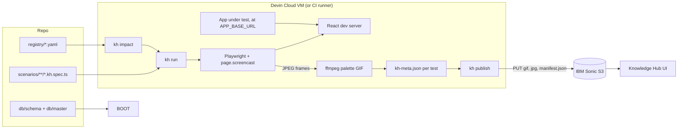

# Knowledge Hub: Scenario GIF Pipeline

Implementation specification

| Field | Value |
|---|---|
| Status | Draft for review, v1.0 |
| Date | 2026-11-01 |
| Owner | Arun (Engineering Excellence) |
| Repo location | `docs/implementation/knowledge-hub.md` |
| Code location | `knowledge-hub/` (new top-level folder) |
| Depends on | `docs/implementation/db-schema-sync.md` (local database inside Devin) |

Legend used throughout: **[Official]** = vendor tool or documented API used as designed. **[Custom]** = code written for this project.

---

## 1. Summary

Every user-facing behaviour of the application gets a short (3 to 10 second) animated GIF that shows a user doing one thing: cursor, highlighted click target, numbered caption per step, and the final result held on screen. Scenarios are declared in one registry, implemented as Playwright tests, recorded inside Devin Cloud against a local copy of the stack, and published to IBM Sonic S3 with a `manifest.json` that the Knowledge Hub UI reads. When an enhancement lands, an impact resolver works out which scenarios are affected, re-records only those, and republishes only GIFs whose content actually changed.

Key design decisions:

1. **No video file is ever written.** Playwright 1.59 added `page.screencast`, which streams JPEG frames through an `onFrame` callback for exactly the window you start and stop **[Official]**. Frames go to memory, then ffmpeg builds the GIF. This replaces the draft's `video: 'on'` + WebM + ffmpeg conversion.
2. **Scenarios are data, not just code.** `registry/` is the single place where scenarios are listed, owned, tagged and mapped to source paths and tables. Specs only implement steps; titles, personas and tags come from the registry.
3. **Content-addressed publishing.** GIF keys include a content signature, so browsers can cache forever and old versions remain for rollback; only `manifest.json` is mutable.
4. **Deterministic recordings.** Fixed clock, seeded randomness, fixed locale/timezone/viewport, seeded database. Identical UI produces an identical signature, which was verified across repeated runs.
5. **Coverage is computed, not hoped for.** Each feature declares its capabilities; the `coverage` command lists every required scenario that does not exist yet and can fail CI.

A sample GIF produced by this exact code against a mock page is attached alongside this document (`sample-projects.project.create.gif`, 5.8 s, 214 KB).

## 2. Goals and non-goals

Goals

- One GIF per user goal, 3 to 10 seconds, readable without sound or narration.
- Centralised registry for every scenario, with owner, module, capability, persona, source impact mapping and status.
- Runs inside Devin Cloud with no access to shared databases or environments.
- GIFs stored in IBM Sonic S3 (S3-compatible API); Knowledge Hub renders from a manifest.
- On every enhancement: detect impacted scenarios, re-record, republish only real changes.
- Mechanical coverage tracking so "every scenario" is measurable.

Non-goals

- Replacing the functional regression suite (scenarios do assert outcomes, but they are optimised for teaching, not edge-case coverage).
- Long-form video tutorials or voice-over.
- Recording against production or shared test environments. Only synthetic seed data.

## 3. Review of the v0 draft

| # | Draft behaviour | Problem | Resolution in this spec |
|---|---|---|---|
| D1 | `video: 'on'` in config | Records the entire test including navigation, login redirect and blank first frames, so clip length cannot be controlled. Also writes a WebM per test, which is the resource cost you wanted to avoid. | `page.screencast.start/stop` around the scenario body only, frames via `onFrame` (Section 6.3). |
| D2 | Viewport 1280x720 with default video size | Playwright scales recordings to fit 800x800 by default, so the draft would have produced 800x450 source frames. | Explicit `size` on `screencast.start`. |
| D3 | Headless recording | Headless captures show no mouse cursor, so viewers cannot see what was clicked. | `screencast.showActions({ cursor: 'pointer', style })` draws cursor, click point and element highlight. Playwright's own action title is suppressed because it shows locator code (for example `Click getByRole('button', ...)`); plain-language captions come from `kh.step()`. |
| D4 | `findWebM()` returns the first `.webm` under `test-results` | With several tests, retries or workers it can pick another scenario's video and publish the wrong GIF. | Each test writes to its own `testInfo.outputPath()`; publisher reads per-test `kh-meta.json`. |
| D5 | One `npx playwright test` process per scenario | N cold starts of Playwright and the browser. | One run with a `--grep` over `@kh:<id>` tags. |
| D6 | Upload overwrites the same key | Browsers and any CDN serve stale GIFs; no rollback. | `scenarios/<module>/<id>/<signature>.gif` with immutable caching, mutable `manifest.json` with `no-cache`, history kept. |
| D7 | URL built as `https://${bucket}.${endpoint}` | Breaks when the endpoint includes `https://`, and virtual-host addressing may not be available on an on-prem store. | `forcePathStyle: true` and a separate `KH_PUBLIC_BASE_URL`. |
| D8 | `ibm-cos-sdk` with IAM API key + service instance id | Fits IBM Cloud with IAM; on-prem or HMAC-only stores need S3 SigV4 with access/secret keys. | `@aws-sdk/client-s3` with HMAC keys **[Official]** (IBM documents S3 API compatibility with HMAC credentials). `ibm-cos-sdk` remains an option if IAM is mandated. |
| D9 | "Seed session" not defined | Login logic would leak into every scenario. | Official Playwright setup project and `storageState` per persona (Section 6.5). |
| D10 | "Devin compares modified code against mappings" | Not deterministic or reviewable. | Rule-based impact resolver with reasons per scenario (Section 8). |
| D11 | No determinism controls | Dates, random ids and data change every run, so every GIF looks "changed". | Fixed clock, seeded `Math.random`, fixed locale/timezone, seeded DB, signature-based change detection. |
| D12 | 15 s timeout covers setup + recording | Fails or truncates for reasons unrelated to the scenario. | 60 s test timeout; separate 3 to 10 s budget enforced on the recorded window only. |
| D13 | Emoji in log output | House style: no emoji in code or generated text. | Plain-text logs. |
| D14 | GIF only | Not accessible; not searchable. | Manifest carries title, description, numbered steps, alt text and a poster image. |

## 4. Architecture



Flow for one scenario:

1. Setup project logs in once per persona and saves `storageState`.
2. Test navigates to the starting page (not recorded).
3. `kh.record()` starts the screencast, shows the cursor overlay, runs the `kh.step()` blocks (each step shows a numbered caption and adds a short beat), holds the final state for 1.5 s, stops.
4. Budget check (3 to 10 s, per-scenario override up to 12 s). Failure fails the test.
5. Fixture teardown, only if the test passed: frames are written with real per-frame durations, ffmpeg builds a two-pass palette GIF (smallest profile under 2.5 MB wins), poster = last frame, `kh-meta.json` written.
6. `kh publish` compares signatures with the live manifest, uploads only new content, updates the manifest.

## 5. Technology choices

| Component | Choice | Type | Notes |
|---|---|---|---|
| Browser automation | `@playwright/test` pinned to 1.64.0 | Official | `page.screencast` (1.59+), `showActions` `cursor` option (1.61+), `style` option (1.64+). Pin exactly; browsers are tied to the version. |
| Auth reuse | Playwright setup project + `storageState` | Official | Pattern from playwright.dev/docs/auth. |
| Time control | `page.clock.setFixedTime` | Official | Freezes `Date` for stable UI text. |
| Impact (test graph) | `playwright test --only-changed=<ref>` | Official | Since 1.46; covers spec and helper changes plus files they import. App source mapping is handled by the custom resolver. |
| GIF encoding | ffmpeg `palettegen` / `paletteuse`, concat demuxer | Official | Installed from Ubuntu apt on the Devin VM (Ubuntu 22.04). |
| Object storage client | `@aws-sdk/client-s3` v3, HMAC, path style | Official | Works with IBM COS S3 API. |
| Registry validation | `zod` + `yaml` | Library | Schema in `registry/schema.ts`. |
| Glob matching | `picomatch` | Library | Impact rules. |
| Runtime | Node.js 24 LTS | Official | Node 20 reached end of life in April 2026. |
| Orchestration CLI | `scripts/kh.ts` | Custom | validate, coverage, impact, run, publish. |

Official references:

- Playwright screencast API: https://playwright.dev/docs/api/class-screencast
- Playwright authentication: https://playwright.dev/docs/auth
- Playwright videos (default sizing behaviour): https://playwright.dev/docs/videos
- IBM COS HMAC credentials: https://cloud.ibm.com/docs/cloud-object-storage?topic=cloud-object-storage-uhc-hmac-credentials-main
- IBM COS with AWS tooling: https://cloud.ibm.com/docs/cloud-object-storage?topic=cloud-object-storage-aws-cli
- AWS SDK for JavaScript v3 S3 client: https://www.npmjs.com/package/@aws-sdk/client-s3
- ffmpeg filters (palettegen, paletteuse): https://ffmpeg.org/ffmpeg-filters.html
- Devin environment configuration: https://docs.devin.ai/onboard-devin/environment-yaml

## 6. Implementation

### 6.1 Repository layout

```text
knowledge-hub/
  package.json
  tsconfig.json
  playwright.config.ts
  registry/
    schema.ts                     zod schema for everything below
    registry.yaml                 personas, global impact globs
    modules/<module>.yaml         modules, features, capabilities, source paths, tables
    scenarios/<module>.yaml       one entry per scenario
  personas/personas.ts            seeded logins per persona, storageState paths
  fixtures/
    auth.setup.ts                 setup project: one login per persona
    kh-test.ts                    test fixture, scenario() helper, determinism
  lib/
    registry.ts                   loader and lookups
    recorder.ts                   screencast window, steps, captions, budget
    gif-encoder.ts                frames -> GIF + poster + signature
    s3-publisher.ts               S3-compatible client (HMAC)
    manifest.ts                   publish + manifest merge
    impact.ts                     changed files -> scenarios, with reasons
  scenarios/<module>/*.kh.spec.ts implementations
  scripts/kh.ts                   CLI
  out/                            gitignored: test-results, impact.md, coverage.md, publish.md
  playwright/.auth/               gitignored: storageState per persona
```

`.gitignore` additions: `knowledge-hub/out/`, `knowledge-hub/playwright/.auth/`, `knowledge-hub/.env`.

### 6.2 Package and Playwright configuration

`knowledge-hub/package.json`

```json
{
  "name": "knowledge-hub",
  "private": true,
  "type": "module",
  "engines": { "node": ">=22" },
  "scripts": {
    "kh": "tsx scripts/kh.ts",
    "kh:validate": "tsx scripts/kh.ts validate",
    "kh:impact": "tsx scripts/kh.ts impact",
    "kh:run": "tsx scripts/kh.ts run",
    "kh:publish": "tsx scripts/kh.ts publish",
    "kh:coverage": "tsx scripts/kh.ts coverage",
    "typecheck": "tsc --noEmit"
  },
  "devDependencies": {
    "@aws-sdk/client-s3": "^3.700.0",
    "@playwright/test": "1.64.0",
    "@types/node": "^22.0.0",
    "picomatch": "^4.0.2",
    "@types/picomatch": "^3.0.1",
    "tsx": "^4.19.0",
    "typescript": "^5.6.0",
    "yaml": "^2.6.0",
    "zod": "^3.23.8"
  }
}
```

`knowledge-hub/playwright.config.ts`

```typescript
import { defineConfig, devices } from '@playwright/test';

export default defineConfig({
  testDir: '.',
  outputDir: 'out/test-results',
  fullyParallel: true,
  workers: Number(process.env.KH_WORKERS ?? 2),
  retries: 1,
  timeout: 60_000, // whole test incl. GIF encode; the recorded window has its own 3-10s budget
  forbidOnly: !!process.env.CI,
  reporter: [['list'], ['json', { outputFile: 'out/results.json' }]],
  use: {
    baseURL: process.env.APP_BASE_URL ?? 'http://localhost:3000',
    locale: 'en-US',
    timezoneId: 'America/New_York',
    colorScheme: 'light',
    video: 'off',
    trace: 'retain-on-failure',
    screenshot: 'only-on-failure',
  },
  projects: [
    { name: 'setup', testMatch: /fixtures\/auth\.setup\.ts$/ },
    {
      name: 'kh',
      testMatch: /scenarios\/.*\.kh\.spec\.ts$/,
      dependencies: ['setup'],
      use: { ...devices['Desktop Chrome'], viewport: { width: 1280, height: 720 }, deviceScaleFactor: 1 },
    },
  ],
  // The app under test is started outside Playwright and reached via APP_BASE_URL.
});
```

### 6.3 Recorder (screencast window, captions, budget)

`knowledge-hub/lib/recorder.ts`

```typescript
import type { Disposable, Page, TestInfo } from '@playwright/test';
import { test } from '@playwright/test';

const escapeHtml = (s: string) => s.replace(/[&<>"']/g, (c) => `&#${c.charCodeAt(0)};`);

/** Bottom caption shown in the GIF while a step runs. Light theme to match the app. */
function captionHtml(n: number, title: string): string {
  return `<div style="position:fixed;left:50%;bottom:24px;transform:translateX(-50%);` +
    `font:600 20px system-ui,sans-serif;color:#0b2a4a;background:rgba(255,255,255,0.95);` +
    `border:1px solid #9cc3f5;padding:8px 16px;border-radius:8px;box-shadow:0 2px 8px rgba(11,42,74,0.15)">` +
    `${n}. ${escapeHtml(title)}</div>`;
}

export interface CapturedFrame {
  data: Buffer;
  /** ms since Unix epoch, as reported by the browser */
  ts: number;
}

export interface StepMark {
  title: string;
  /** ms offset from recording start */
  atMs: number;
}

export interface Recording {
  frames: CapturedFrame[];
  steps: StepMark[];
  startTs: number;
  endTs: number;
}

export interface RecorderOptions {
  size: { width: number; height: number };
  jpegQuality: number;
  /** Time to keep the final state on screen so viewers can read the result. */
  holdLastMs: number;
  /** Pause after each step so a human can follow it. */
  beatMs: number;
  maxSeconds: number;
  minSeconds: number;
}

export const RECORDER_DEFAULTS: RecorderOptions = {
  size: { width: 1280, height: 720 },
  jpegQuality: 85,
  holdLastMs: 1500,
  beatMs: 350,
  maxSeconds: 10,
  minSeconds: 3,
};

/**
 * Records only the window inside kh.record(), using page.screencast (Playwright >= 1.59).
 * No WebM is written: JPEG frames are streamed to memory through onFrame.
 */
export class ScenarioRecorder {
  private recording?: Recording;
  private active = false;
  private frames: CapturedFrame[] = [];
  private steps: StepMark[] = [];
  private startTs = 0;
  private caption?: Disposable;

  constructor(
    private readonly page: Page,
    private readonly testInfo: TestInfo,
    private readonly opts: RecorderOptions,
  ) {}

  async record(body: () => Promise<void>): Promise<void> {
    if (this.recording || this.active) throw new Error('kh.record() can be called once per scenario');
    this.active = true;
    const sc = this.page.screencast;
    this.startTs = Date.now();
    await sc.start({
      size: this.opts.size,
      quality: this.opts.jpegQuality,
      onFrame: ({ data, timestamp }) => {
        this.frames.push({ data: Buffer.from(data), ts: timestamp });
      },
    });
    // Cursor + click point + element highlight. `title` is omitted on purpose: Playwright's
    // action title shows locator code, which means nothing to end users. Captions come from kh.step().
    await sc.showActions({
      duration: 700,
      cursor: 'pointer',
      style: {
        point: 'width: 18px; height: 18px; border-radius: 50%; background: rgba(30, 110, 230, 0.55); border: 2px solid #ffffff',
        highlight: 'outline: 3px solid rgba(30, 110, 230, 0.9); border-radius: 4px',
      },
    });
    try {
      await body();
      await this.page.waitForTimeout(this.opts.holdLastMs);
    } finally {
      await this.caption?.dispose();
      await sc.hideActions();
      await sc.stop();
      this.active = false;
    }
    const endTs = Date.now();
    const firstTs = this.frames[0]?.ts ?? this.startTs;
    this.recording = { frames: this.frames, steps: this.steps, startTs: Math.min(firstTs, this.startTs), endTs };
    this.assertBudget();
  }

  /** Wraps test.step so the step title is also captured as a caption for the Knowledge Hub. */
  async step<T>(title: string, body: () => Promise<T>): Promise<T> {
    if (this.active) {
      this.steps.push({ title, atMs: Date.now() - this.startTs });
      await this.caption?.dispose();
      this.caption = await this.page.screencast.showOverlay(captionHtml(this.steps.length, title));
    }
    const result = await test.step(title, body);
    if (this.active) await this.page.waitForTimeout(this.opts.beatMs);
    return result;
  }

  result(): Recording | undefined {
    return this.recording;
  }

  private assertBudget(): void {
    const r = this.recording!;
    const seconds = (r.endTs - r.startTs) / 1000;
    this.testInfo.annotations.push({ type: 'kh-duration-seconds', description: seconds.toFixed(2) });
    if (r.frames.length === 0) throw new Error('kh: no frames captured; is the page rendering?');
    if (seconds > this.opts.maxSeconds) {
      throw new Error(`kh: scenario recording is ${seconds.toFixed(1)}s; budget is ${this.opts.maxSeconds}s. Split the scenario or move setup out of kh.record().`);
    }
    if (seconds < this.opts.minSeconds) {
      throw new Error(`kh: scenario recording is ${seconds.toFixed(1)}s; minimum is ${this.opts.minSeconds}s so viewers can follow it.`);
    }
  }
}
```

### 6.4 GIF encoder

Frames arrive only when the page repaints, so their spacing is irregular. The encoder writes an ffconcat list with each frame's real duration, which keeps timing faithful and makes static periods cheap. Profiles step down (960 px / 10 fps / 128 colours, then 800 / 8 / 96, then 640 / 8 / 64) until the GIF is under 2.5 MB. The signature hashes the final frame plus the narrative (title, description, step titles); it is stable across runs when the UI is unchanged.

`knowledge-hub/lib/gif-encoder.ts`

```typescript
import { execFile } from 'node:child_process';
import crypto from 'node:crypto';
import fs from 'node:fs';
import path from 'node:path';
import { promisify } from 'node:util';
import type { Recording } from './recorder';

const run = promisify(execFile);

export interface GifProfile { width: number; fps: number; colors: number }

/** Tried in order until the GIF fits under maxBytes. */
export const GIF_PROFILES: GifProfile[] = [
  { width: 960, fps: 10, colors: 128 },
  { width: 800, fps: 8, colors: 96 },
  { width: 640, fps: 8, colors: 64 },
];

export interface EncodedAsset {
  gifPath: string;
  posterPath: string;
  bytes: number;
  width: number;
  fps: number;
  durationMs: number;
  /** Stable fingerprint of what the viewer sees at the end + the narrative. Used to skip unchanged uploads. */
  signature: string;
}

export async function encodeGif(rec: Recording, outDir: string, narrative: string, maxBytes = 2_500_000): Promise<EncodedAsset> {
  const framesDir = path.join(outDir, 'frames');
  fs.mkdirSync(framesDir, { recursive: true });

  // 1. Write frames and an ffconcat list with real per-frame durations (frames only arrive on repaint).
  const lines = ['ffconcat version 1.0'];
  rec.frames.forEach((f, i) => {
    const name = `${String(i).padStart(5, '0')}.jpg`;
    fs.writeFileSync(path.join(framesDir, name), f.data);
    const next = rec.frames[i + 1]?.ts ?? rec.endTs;
    const seconds = Math.max(0.02, (next - f.ts) / 1000);
    lines.push(`file '${name}'`, `duration ${seconds.toFixed(3)}`);
  });
  // The concat demuxer ignores the last duration unless the last file is listed again.
  lines.push(`file '${String(rec.frames.length - 1).padStart(5, '0')}.jpg'`);
  const listPath = path.join(framesDir, 'frames.ffconcat');
  fs.writeFileSync(listPath, lines.join('\n') + '\n');

  // 2. Poster = final frame (what the user should end up seeing).
  const posterPath = path.join(outDir, 'poster.jpg');
  const last = rec.frames[rec.frames.length - 1];
  fs.writeFileSync(posterPath, last.data);

  // 3. Two-pass palette GIF, smallest acceptable profile wins.
  const gifPath = path.join(outDir, 'scenario.gif');
  let used: GifProfile | undefined;
  for (const p of GIF_PROFILES) {
    const vf =
      `fps=${p.fps},scale=${p.width}:-1:flags=lanczos,split[a][b];` +
      `[a]palettegen=max_colors=${p.colors}:stats_mode=diff[pal];` +
      `[b][pal]paletteuse=dither=bayer:bayer_scale=4:diff_mode=rectangle`;
    await run('ffmpeg', ['-y', '-loglevel', 'error', '-f', 'concat', '-safe', '0', '-i', listPath, '-vf', vf, '-loop', '0', gifPath]);
    used = p;
    if (fs.statSync(gifPath).size <= maxBytes) break;
  }
  const bytes = fs.statSync(gifPath).size;
  if (bytes > maxBytes) throw new Error(`kh: GIF is ${bytes} bytes after all profiles; shorten the scenario`);

  fs.rmSync(framesDir, { recursive: true, force: true });

  const signature = crypto.createHash('sha256').update(last.data).update(narrative).digest('hex').slice(0, 16);
  return { gifPath, posterPath, bytes, width: used!.width, fps: used!.fps, durationMs: rec.endTs - rec.startTs, signature };
}
```

### 6.5 Fixture, determinism and the `scenario()` helper

`knowledge-hub/fixtures/kh-test.ts`

```typescript
import fs from 'node:fs';
import { test as base, expect, type Page } from '@playwright/test';
import { encodeGif } from '../lib/gif-encoder';
import { RECORDER_DEFAULTS, ScenarioRecorder } from '../lib/recorder';
import { getScenario } from '../lib/registry';
import type { Scenario } from '../registry/schema';
import { authFile } from '../personas/personas';

/** Fixed "now" so dates, relative times and greetings never change between runs. */
export const KH_FIXED_NOW = new Date('2026-01-15T14:30:00-05:00');

export interface KhApi {
  /** Everything inside this callback is recorded. Navigation and setup go before it. */
  record(body: () => Promise<void>): Promise<void>;
  /** A visible, captioned step. Use 2 to 6 per scenario. */
  step<T>(title: string, body: () => Promise<T>): Promise<T>;
  /** Hide volatile regions (build numbers, live clocks) from the GIF. */
  mask(selectors: string[]): Promise<void>;
}

export interface KhMeta {
  scenarioId: string;
  gif: string;
  poster: string;
  bytes: number;
  width: number;
  fps: number;
  durationMs: number;
  signature: string;
  steps: { title: string; atMs: number }[];
  appVersion: string;
  gitSha: string;
  recordedAt: string;
}

async function applyDeterminism(page: Page): Promise<void> {
  await page.clock.setFixedTime(KH_FIXED_NOW);
  await page.addInitScript(() => {
    const seed = { v: 42 };
    Math.random = () => ((seed.v = (seed.v * 16807) % 2147483647) - 1) / 2147483646;
  });
}

export const test = base.extend<{ kh: KhApi }>({
  kh: async ({ page }, use, testInfo) => {
    const tag = testInfo.tags.find((t) => t.startsWith('@kh:'));
    if (!tag) throw new Error('kh fixture used outside scenario(); register the scenario first');
    const scenario = getScenario(tag.slice(4));
    await applyDeterminism(page);
    const recorder = new ScenarioRecorder(page, testInfo, { ...RECORDER_DEFAULTS, maxSeconds: scenario.maxSeconds });

    await use({
      record: (body) => recorder.record(body),
      step: (title, body) => recorder.step(title, body),
      mask: async (selectors) => {
        await page.addStyleTag({ content: `${selectors.join(', ')} { visibility: hidden !important; }` });
      },
    });

    const rec = recorder.result();
    if (!rec || testInfo.status !== testInfo.expectedStatus) return;
    const narrative = JSON.stringify({ t: scenario.title, d: scenario.description, s: rec.steps.map((s) => s.title) });
    const asset = await encodeGif(rec, testInfo.outputPath('kh'), narrative);
    const meta: KhMeta = {
      scenarioId: scenario.id,
      gif: asset.gifPath,
      poster: asset.posterPath,
      bytes: asset.bytes,
      width: asset.width,
      fps: asset.fps,
      durationMs: asset.durationMs,
      signature: asset.signature,
      steps: rec.steps,
      appVersion: process.env.APP_VERSION ?? 'local',
      gitSha: process.env.GIT_SHA ?? 'local',
      recordedAt: new Date().toISOString(),
    };
    fs.writeFileSync(testInfo.outputPath('kh', 'kh-meta.json'), JSON.stringify(meta, null, 2));
    await testInfo.attach('kh-gif', { path: asset.gifPath, contentType: 'image/gif' });
  },
});

export { expect };

type ScenarioBody = (args: { page: Page; kh: KhApi; scenario: Scenario }) => Promise<void>;

/**
 * Declares a Knowledge Hub scenario. Title, persona and tags come from the registry,
 * so the registry stays the single place where scenarios are managed.
 */
export function scenario(id: string, body: ScenarioBody): void {
  const s = getScenario(id);
  test.describe(() => {
    test.use({ storageState: authFile(s.persona) });
    test(
      s.title,
      { tag: [`@kh:${s.id}`, `@module:${s.module}`, `@cap:${s.capability}`, `@persona:${s.persona}`] },
      async ({ page, kh }) => {
        await body({ page, kh, scenario: s });
      },
    );
  });
}
```

`knowledge-hub/personas/personas.ts`

```typescript
import path from 'node:path';
import { KH_ROOT, loadRegistry } from '../lib/registry';

/** Seeded login per persona. Usernames must exist in the app under test; the shared password comes from a Devin secret. */
export const PERSONA_LOGINS: Record<string, { username: string }> = {
  analyst: { username: 'kh.analyst' },
  manager: { username: 'kh.manager' },
  admin: { username: 'kh.admin' },
};

export function authFile(personaId: string): string {
  return path.join(KH_ROOT, 'playwright', '.auth', `${personaId}.json`);
}

export function personaIds(): string[] {
  return loadRegistry().personas.map((p) => p.id);
}
```

`knowledge-hub/fixtures/auth.setup.ts`

```typescript
import fs from 'node:fs';
import path from 'node:path';
import { test as setup, expect } from '@playwright/test';
import { authFile, PERSONA_LOGINS, personaIds } from '../personas/personas';

// Official Playwright pattern: authenticate once per persona in a setup project, reuse storageState.
// Adjust selectors/endpoint to the app's local-profile login. Never point this at a shared environment.
for (const id of personaIds()) {
  setup(`authenticate ${id}`, async ({ page }) => {
    const login = PERSONA_LOGINS[id];
    if (!login) throw new Error(`No seeded login for persona ${id}`);
    await page.goto('/login');
    await page.getByLabel('Username').fill(login.username);
    await page.getByLabel('Password').fill(process.env.KH_SEED_PASSWORD ?? '');
    await page.getByRole('button', { name: 'Sign in' }).click();
    await expect(page.getByTestId('app-shell')).toBeVisible();
    fs.mkdirSync(path.dirname(authFile(id)), { recursive: true });
    await page.context().storageState({ path: authFile(id) });
  });
}
```

### 6.6 Registry

`knowledge-hub/registry/schema.ts`

```typescript
import { z } from 'zod';

export const Capability = z.enum([
  'nav', 'auth', 'list', 'view', 'create', 'edit', 'delete', 'search', 'filter', 'sort',
  'bulk', 'import', 'export', 'upload', 'workflow', 'rbac', 'validation', 'empty',
  'notify', 'audit', 'settings', 'help',
]);
export type Capability = z.infer<typeof Capability>;

const Id = z.string().regex(/^[a-z0-9]+(\.[a-z0-9-]+)+$/, 'ids look like module.feature.capability[.variant]');

export const Feature = z.object({
  id: z.string().regex(/^[a-z0-9-]+$/),
  name: z.string(),
  routes: z.array(z.string()).default([]),
  capabilities: z.array(Capability).min(1),
  personas: z.array(z.string()).min(1),
  /** Capabilities whose UI differs by persona; one scenario per persona is required for these. */
  personaSensitive: z.array(Capability).default([]),
});

export const Module = z.object({
  id: z.string().regex(/^[a-z0-9-]+$/),
  name: z.string(),
  owner: z.string(),
  frontendPaths: z.array(z.string()).default([]),
  backendPaths: z.array(z.string()).default([]),
  dbTables: z.array(z.string()).default([]),
  features: z.array(Feature).min(1),
});

export const Scenario = z.object({
  id: Id,
  title: z.string().min(5).max(80),
  description: z.string().min(10).max(300),
  module: z.string(),
  feature: z.string(),
  capability: Capability,
  persona: z.string(),
  owner: z.string(),
  spec: z.string().regex(/\.kh\.spec\.ts$/),
  routes: z.array(z.string()).default([]),
  impactGlobs: z.array(z.string()).default([]),
  dataDeps: z.array(z.string()).default([]),
  maxSeconds: z.number().min(3).max(12).default(10),
  status: z.enum(['active', 'draft', 'deprecated', 'waived']).default('active'),
  waiverReason: z.string().optional(),
  audience: z.array(z.enum(['end-user', 'admin', 'support'])).default(['end-user']),
  sinceRelease: z.string().optional(),
  order: z.number().int().default(100),
});

export const Registry = z
  .object({
    version: z.literal(1),
    globalImpact: z.array(z.string()),
    personas: z.array(z.object({ id: z.string(), label: z.string() })).min(1),
    modules: z.array(Module),
    scenarios: z.array(Scenario),
  })
  .superRefine((r, ctx) => {
    const seen = new Set<string>();
    const personas = new Set(r.personas.map((p) => p.id));
    const features = new Map<string, Set<string>>(
      r.modules.map((m) => [m.id, new Set(m.features.map((f) => f.id))]),
    );
    for (const s of r.scenarios) {
      if (seen.has(s.id)) ctx.addIssue({ code: 'custom', message: `duplicate scenario id ${s.id}` });
      seen.add(s.id);
      if (!personas.has(s.persona)) ctx.addIssue({ code: 'custom', message: `${s.id}: unknown persona ${s.persona}` });
      if (!features.get(s.module)?.has(s.feature)) {
        ctx.addIssue({ code: 'custom', message: `${s.id}: unknown module/feature ${s.module}/${s.feature}` });
      }
      if (s.status === 'waived' && !s.waiverReason) {
        ctx.addIssue({ code: 'custom', message: `${s.id}: waived scenarios need waiverReason` });
      }
    }
  });

export type Registry = z.infer<typeof Registry>;
export type Scenario = z.infer<typeof Scenario>;
export type Module = z.infer<typeof Module>;
```

`knowledge-hub/lib/registry.ts`

```typescript
import fs from 'node:fs';
import path from 'node:path';
import { fileURLToPath } from 'node:url';
import YAML from 'yaml';
import { Registry, type Scenario } from '../registry/schema';

export const KH_ROOT = path.resolve(path.dirname(fileURLToPath(import.meta.url)), '..');
const REG_DIR = path.join(KH_ROOT, 'registry');

function readYaml(file: string): any {
  return YAML.parse(fs.readFileSync(file, 'utf8')) ?? {};
}

function readDir(dir: string): any[] {
  if (!fs.existsSync(dir)) return [];
  return fs
    .readdirSync(dir)
    .filter((f) => f.endsWith('.yaml'))
    .sort()
    .map((f) => readYaml(path.join(dir, f)));
}

let cached: Registry | undefined;

/** Merges registry/registry.yaml + registry/modules/*.yaml + registry/scenarios/*.yaml and validates. */
export function loadRegistry(): Registry {
  if (cached) return cached;
  const root = readYaml(path.join(REG_DIR, 'registry.yaml'));
  const modules = readDir(path.join(REG_DIR, 'modules')).flatMap((d) => d.modules ?? []);
  const scenarios = readDir(path.join(REG_DIR, 'scenarios')).flatMap((d) => d.scenarios ?? []);
  cached = Registry.parse({ ...root, modules, scenarios });
  return cached;
}

export function getScenario(id: string): Scenario {
  const s = loadRegistry().scenarios.find((x) => x.id === id);
  if (!s) throw new Error(`Scenario "${id}" is not registered in knowledge-hub/registry/scenarios/*.yaml`);
  return s;
}

export function activeScenarios(): Scenario[] {
  return loadRegistry().scenarios.filter((s) => s.status === 'active');
}
```

`knowledge-hub/registry/registry.yaml`

```yaml
version: 1

# Any change matching these globs re-runs every active scenario.
globalImpact:
  - "frontend/package.json"
  - "frontend/package-lock.json"
  - "frontend/src/app/**"              # shell, layout, router
  - "frontend/src/design-system/**"    # shared components and theme
  - "frontend/src/auth/**"
  - "frontend/src/i18n/**"
  - "backend/**/security/**"
  - "knowledge-hub/fixtures/**"
  - "knowledge-hub/lib/recorder.ts"
  - "knowledge-hub/lib/gif-encoder.ts"
  - "knowledge-hub/playwright.config.ts"

personas:
  - { id: analyst, label: "Analyst" }
  - { id: manager, label: "Manager" }
  - { id: admin, label: "Administrator" }
```

`knowledge-hub/registry/modules/projects.yaml`

```yaml
modules:
  - id: projects
    name: Projects
    owner: "team-projects"
    frontendPaths: ["frontend/src/features/projects/**"]
    backendPaths: ["backend/src/main/java/**/project/**"]
    dbTables: ["app.project", "app.project_status"]
    features:
      - id: project
        name: Project
        routes: ["/projects", "/projects/:id", "/projects/:id/edit"]
        capabilities: [list, view, create, edit, delete, search, filter, validation, empty, workflow, rbac]
        personas: [analyst, manager, admin]
        personaSensitive: [delete, workflow]
```

`knowledge-hub/registry/scenarios/projects.yaml`

```yaml
scenarios:
  - id: projects.project.create
    title: "Create a new project"
    description: "Open the Projects page, start a new project, enter a name and save it. The new project appears in the list."
    module: projects
    feature: project
    capability: create
    persona: analyst
    spec: scenarios/projects/project-create.kh.spec.ts
    routes: ["/projects"]
    impactGlobs:
      - "frontend/src/features/projects/components/ProjectForm*"
      - "frontend/src/features/projects/pages/ProjectList*"
      - "backend/src/main/java/**/project/ProjectController.java"
    dataDeps: ["app.project", "app.project_status"]
    maxSeconds: 10
    owner: "team-projects"

  - id: projects.project.create.validation-error
    title: "See validation errors when creating a project"
    description: "Try to save a project without a name and see the inline error message that explains what is required."
    module: projects
    feature: project
    capability: validation
    persona: analyst
    spec: scenarios/projects/project-create.kh.spec.ts
    impactGlobs: ["frontend/src/features/projects/components/ProjectForm*"]
    owner: "team-projects"
```

### 6.7 Scenario implementation example

`knowledge-hub/scenarios/projects/project-create.kh.spec.ts`

```typescript
import { expect, scenario } from '../../fixtures/kh-test';

scenario('projects.project.create', async ({ page, kh }) => {
  // Setup: not recorded.
  await page.goto('/projects');
  await expect(page.getByRole('heading', { name: 'Projects' })).toBeVisible();

  await kh.record(async () => {
    await kh.step('Open the New project form', async () => {
      await page.getByRole('button', { name: 'New project' }).click();
      await expect(page.getByRole('dialog', { name: 'New project' })).toBeVisible();
    });
    await kh.step('Enter the project name', async () => {
      await page.getByLabel('Project name').pressSequentially('Analytics Module', { delay: 40 });
    });
    await kh.step('Save the project', async () => {
      await page.getByRole('button', { name: 'Save' }).click();
      await expect(page.getByRole('row', { name: /Analytics Module/ })).toBeVisible();
    });
  });
});

scenario('projects.project.create.validation-error', async ({ page, kh }) => {
  await page.goto('/projects');
  await page.getByRole('button', { name: 'New project' }).click();

  await kh.record(async () => {
    await kh.step('Save without a name', async () => {
      await page.getByRole('button', { name: 'Save' }).click();
    });
    await kh.step('Read the required-field message', async () => {
      await expect(page.getByText('Project name is required')).toBeVisible();
    });
  });
});
```

### 6.8 Publisher and manifest

S3 key layout:

```text
<prefix>/manifest.json                                   Cache-Control: no-cache
<prefix>/manifests/history/<timestamp>.json              snapshot per publish that changed something
<prefix>/scenarios/<module>/<scenario-id>/<sig>.gif      Cache-Control: public, max-age=31536000, immutable
<prefix>/scenarios/<module>/<scenario-id>/<sig>.jpg      poster (final frame)
```

Retention: the manifest keeps the last 5 versions per scenario in `history`. Delete older objects with a bucket lifecycle rule or a periodic cleanup job; nothing in the pipeline deletes objects.

`knowledge-hub/lib/s3-publisher.ts`

```typescript
import fs from 'node:fs';
import { GetObjectCommand, PutObjectCommand, S3Client } from '@aws-sdk/client-s3';

export interface StoreConfig {
  endpoint: string;       // e.g. https://s3.<region>.cloud-object-storage.appdomain.cloud or the on-prem endpoint
  region: string;
  bucket: string;
  prefix: string;         // e.g. knowledge-hub
  publicBaseUrl: string;  // what browsers use to load assets (CDN, proxy or bucket URL)
}

export function storeConfigFromEnv(): StoreConfig {
  const need = (k: string) => {
    const v = process.env[k];
    if (!v) throw new Error(`Missing env ${k}`);
    return v;
  };
  return {
    endpoint: need('KH_S3_ENDPOINT'),
    region: process.env.KH_S3_REGION ?? 'us-east-1',
    bucket: need('KH_S3_BUCKET'),
    prefix: (process.env.KH_S3_PREFIX ?? 'knowledge-hub').replace(/^\/+|\/+$/g, ''),
    publicBaseUrl: need('KH_PUBLIC_BASE_URL').replace(/\/+$/, ''),
  };
}

/** S3-compatible client using HMAC keys (IBM COS supports the S3 API with HMAC credentials). */
export function createClient(cfg: StoreConfig): S3Client {
  return new S3Client({
    endpoint: cfg.endpoint,
    region: cfg.region,
    forcePathStyle: true,
    credentials: {
      accessKeyId: process.env.KH_S3_ACCESS_KEY_ID ?? '',
      secretAccessKey: process.env.KH_S3_SECRET_ACCESS_KEY ?? '',
    },
  });
}

export async function putFile(client: S3Client, cfg: StoreConfig, key: string, file: string, contentType: string, immutable: boolean): Promise<string> {
  await client.send(
    new PutObjectCommand({
      Bucket: cfg.bucket,
      Key: key,
      Body: fs.readFileSync(file),
      ContentType: contentType,
      CacheControl: immutable ? 'public, max-age=31536000, immutable' : 'no-cache',
    }),
  );
  return `${cfg.publicBaseUrl}/${key}`;
}

export async function putJson(client: S3Client, cfg: StoreConfig, key: string, value: unknown): Promise<void> {
  await client.send(
    new PutObjectCommand({
      Bucket: cfg.bucket,
      Key: key,
      Body: JSON.stringify(value, null, 2),
      ContentType: 'application/json',
      CacheControl: 'no-cache',
    }),
  );
}

export async function getJson<T>(client: S3Client, cfg: StoreConfig, key: string): Promise<T | undefined> {
  try {
    const res = await client.send(new GetObjectCommand({ Bucket: cfg.bucket, Key: key }));
    const text = await res.Body?.transformToString();
    return text ? (JSON.parse(text) as T) : undefined;
  } catch (err: any) {
    if (err?.name === 'NoSuchKey' || err?.$metadata?.httpStatusCode === 404) return undefined;
    throw err;
  }
}
```

`knowledge-hub/lib/manifest.ts`

```typescript
import fs from 'node:fs';
import path from 'node:path';
import type { KhMeta } from '../fixtures/kh-test';
import type { Registry } from '../registry/schema';
import { createClient, getJson, putFile, putJson, storeConfigFromEnv } from './s3-publisher';

export interface ManifestEntry {
  id: string;
  module: string;
  moduleName: string;
  feature: string;
  capability: string;
  persona: string;
  audience: string[];
  title: string;
  description: string;
  alt: string;
  steps: { title: string; atMs: number }[];
  gifUrl: string;
  posterUrl: string;
  bytes: number;
  width: number;
  durationMs: number;
  signature: string;
  appVersion: string;
  gitSha: string;
  updatedAt: string;
  status: 'active' | 'deprecated';
  order: number;
  history: { signature: string; gifUrl: string; updatedAt: string }[];
}

export interface Manifest {
  schemaVersion: 1;
  generatedAt: string;
  entries: Record<string, ManifestEntry>;
}

export function collectMetas(resultsDir: string): KhMeta[] {
  const found: KhMeta[] = [];
  const walk = (dir: string) => {
    if (!fs.existsSync(dir)) return;
    for (const e of fs.readdirSync(dir, { withFileTypes: true })) {
      const p = path.join(dir, e.name);
      if (e.isDirectory()) walk(p);
      else if (e.name === 'kh-meta.json') found.push(JSON.parse(fs.readFileSync(p, 'utf8')));
    }
  };
  walk(resultsDir);
  // If a scenario passed on retry, keep the latest recording.
  const byId = new Map<string, KhMeta>();
  for (const m of found.sort((a, b) => a.recordedAt.localeCompare(b.recordedAt))) byId.set(m.scenarioId, m);
  return [...byId.values()];
}

export async function publish(registry: Registry, resultsDir: string, opts: { force: boolean; dryRun: boolean; keepHistory: number }) {
  const cfg = storeConfigFromEnv();
  const client = createClient(cfg);
  const manifestKey = `${cfg.prefix}/manifest.json`;
  const manifest: Manifest = (await getJson<Manifest>(client, cfg, manifestKey)) ?? { schemaVersion: 1, generatedAt: '', entries: {} };
  const report: string[] = [];

  for (const meta of collectMetas(resultsDir)) {
    const s = registry.scenarios.find((x) => x.id === meta.scenarioId);
    if (!s) { report.push(`SKIP ${meta.scenarioId}: not in registry`); continue; }
    const prev = manifest.entries[s.id];
    if (prev && prev.signature === meta.signature && !opts.force) { report.push(`UNCHANGED ${s.id}`); continue; }

    const base = `${cfg.prefix}/scenarios/${s.module}/${s.id}/${meta.signature}`;
    const gifUrl = opts.dryRun ? `${cfg.publicBaseUrl}/${base}.gif` : await putFile(client, cfg, `${base}.gif`, meta.gif, 'image/gif', true);
    const posterUrl = opts.dryRun ? `${cfg.publicBaseUrl}/${base}.jpg` : await putFile(client, cfg, `${base}.jpg`, meta.poster, 'image/jpeg', true);
    const mod = registry.modules.find((m) => m.id === s.module)!;
    const now = new Date().toISOString();
    manifest.entries[s.id] = {
      id: s.id, module: s.module, moduleName: mod.name, feature: s.feature, capability: s.capability,
      persona: s.persona, audience: s.audience, title: s.title, description: s.description,
      alt: `${s.title}. ${meta.steps.map((x, i) => `Step ${i + 1}: ${x.title}.`).join(' ')}`,
      steps: meta.steps, gifUrl, posterUrl, bytes: meta.bytes, width: meta.width, durationMs: meta.durationMs,
      signature: meta.signature, appVersion: meta.appVersion, gitSha: meta.gitSha, updatedAt: now,
      status: 'active', order: s.order,
      history: [
        ...(prev && prev.signature !== meta.signature ? [{ signature: prev.signature, gifUrl: prev.gifUrl, updatedAt: prev.updatedAt }] : []),
        ...(prev?.history ?? []),
      ].slice(0, opts.keepHistory),
    };
    report.push(`${prev ? 'UPDATED' : 'ADDED'} ${s.id} (${(meta.bytes / 1024).toFixed(0)} KB, ${(meta.durationMs / 1000).toFixed(1)}s)`);
  }

  for (const s of registry.scenarios) {
    const e = manifest.entries[s.id];
    if (e && s.status === 'deprecated' && e.status !== 'deprecated') { e.status = 'deprecated'; report.push(`DEPRECATED ${s.id}`); }
  }

  const changed = report.some((r) => /^(ADDED|UPDATED|DEPRECATED) /.test(r));
  manifest.generatedAt = new Date().toISOString();
  if (changed && !opts.dryRun) {
    await putJson(client, cfg, `${cfg.prefix}/manifests/history/${manifest.generatedAt.replace(/[:.]/g, '-')}.json`, manifest);
    await putJson(client, cfg, manifestKey, manifest);
  }
  return report;
}
```

Manifest entry (from the test run; `appVersion`, `gitSha` and `updatedAt` omitted for brevity):

```json
{
  "id": "projects.project.create",
  "module": "projects",
  "moduleName": "Projects",
  "feature": "project",
  "capability": "create",
  "persona": "analyst",
  "audience": ["end-user"],
  "title": "Create a new project",
  "description": "Open the Projects page, start a new project, enter a name and save it. The new project appears in the list.",
  "alt": "Create a new project. Step 1: Open the New project form. Step 2: Enter the project name. Step 3: Save the project.",
  "steps": [
    { "title": "Open the New project form", "atMs": 9 },
    { "title": "Enter the project name", "atMs": 1220 },
    { "title": "Save the project", "atMs": 2996 }
  ],
  "gifUrl": "https://kh.example.internal/knowledge-hub/scenarios/projects/projects.project.create/601c214c22b77848.gif",
  "posterUrl": "https://kh.example.internal/knowledge-hub/scenarios/projects/projects.project.create/601c214c22b77848.jpg",
  "bytes": 218626,
  "width": 960,
  "durationMs": 5764,
  "signature": "601c214c22b77848",
  "status": "active",
  "order": 100,
  "history": []
}
```

### 6.9 CLI

`knowledge-hub/scripts/kh.ts`

```typescript
#!/usr/bin/env tsx
import { execFileSync, spawnSync } from 'node:child_process';
import fs from 'node:fs';
import path from 'node:path';
import { parseArgs } from 'node:util';
import { resolveImpact } from '../lib/impact';
import { publish } from '../lib/manifest';
import { KH_ROOT, loadRegistry } from '../lib/registry';

// Node built-in (>= 20.12): load knowledge-hub/.env written by Devin maintenance; child Playwright inherits it.
if (fs.existsSync(path.join(KH_ROOT, '.env'))) process.loadEnvFile(path.join(KH_ROOT, '.env'));

const OUT = path.join(KH_ROOT, 'out');
const RESULTS = path.join(OUT, 'test-results');

const { positionals, values } = parseArgs({
  allowPositionals: true,
  options: {
    base: { type: 'string', default: 'origin/main' },
    ids: { type: 'string' },
    impacted: { type: 'boolean', default: false },
    all: { type: 'boolean', default: false },
    force: { type: 'boolean', default: false },
    'dry-run': { type: 'boolean', default: false },
    strict: { type: 'boolean', default: false },
  },
});

const esc = (s: string) => s.replace(/[.*+?^${}()|[\]\\]/g, '\\$&');
function write(file: string, content: string) {
  fs.mkdirSync(path.dirname(file), { recursive: true });
  fs.writeFileSync(file, content);
}

function listTaggedTests(): Set<string> {
  const out = execFileSync('npx', ['playwright', 'test', '--list', '--reporter=json', '--project=kh'], {
    cwd: KH_ROOT, encoding: 'utf8', maxBuffer: 64 * 1024 * 1024,
  });
  const ids = new Set<string>();
  const walk = (suite: any) => {
    for (const spec of suite.specs ?? []) for (const t of spec.tags ?? []) {
      const tag = String(t).replace(/^@?/, '@');
      if (tag.startsWith('@kh:')) ids.add(tag.slice(4));
    }
    for (const c of suite.suites ?? []) walk(c);
  };
  for (const s of JSON.parse(out).suites ?? []) walk(s);
  return ids;
}

function validate(): number {
  const reg = loadRegistry(); // throws with zod errors if invalid
  const errors: string[] = [];
  for (const s of reg.scenarios) {
    if (!fs.existsSync(path.join(KH_ROOT, s.spec))) errors.push(`${s.id}: spec file missing ${s.spec}`);
  }
  const implemented = listTaggedTests();
  for (const s of reg.scenarios.filter((x) => x.status === 'active')) {
    if (!implemented.has(s.id)) errors.push(`${s.id}: active in registry but no test calls scenario('${s.id}')`);
  }
  console.log(errors.length ? errors.join('\n') : `registry OK: ${reg.scenarios.length} scenarios, ${reg.modules.length} modules`);
  return errors.length ? 1 : 0;
}

function coverage(): number {
  const reg = loadRegistry();
  const rows: string[] = ['| Module | Feature | Capability | Persona | Scenario | Status |', '|---|---|---|---|---|---|'];
  let missing = 0;
  for (const m of reg.modules) for (const f of m.features) for (const cap of f.capabilities) {
    const personas = f.personaSensitive.includes(cap) ? f.personas : [null];
    for (const p of personas) {
      const match = reg.scenarios.find((s) => s.module === m.id && s.feature === f.id && s.capability === cap && (p === null || s.persona === p) && s.status !== 'deprecated');
      const status = match ? match.status : 'MISSING';
      if (!match) missing++;
      rows.push(`| ${m.id} | ${f.id} | ${cap} | ${p ?? 'any'} | ${match?.id ?? '-'} | ${status} |`);
    }
  }
  const md = `# Knowledge Hub coverage\n\nRequired cells: ${rows.length - 2}. Missing: ${missing}.\n\n${rows.join('\n')}\n`;
  write(path.join(OUT, 'coverage.md'), md);
  console.log(`coverage: ${missing} missing of ${rows.length - 2} required (out/coverage.md)`);
  return values.strict && missing > 0 ? 1 : 0;
}

function selectIds(): string[] | 'all' {
  const reg = loadRegistry();
  if (values.all) return 'all';
  if (values.ids) return values.ids.split(',').map((s) => s.trim()).filter(Boolean);
  if (values.impacted) {
    const impact = resolveImpact(reg, values.base!);
    write(path.join(OUT, 'impact.json'), JSON.stringify(impact, null, 2));
    return impact.runAll ? 'all' : impact.scenarios.map((s) => s.id);
  }
  throw new Error('run needs --all, --ids a,b or --impacted');
}

function run(): number {
  const ids = selectIds();
  if (ids !== 'all' && ids.length === 0) { console.log('no impacted scenarios'); return 0; }
  fs.rmSync(RESULTS, { recursive: true, force: true });
  const grep = ids === 'all' ? '@kh:' : `@kh:(?:${ids.map(esc).join('|')})(?![\\w.-])`;
  const res = spawnSync('npx', ['playwright', 'test', '--project=kh', '--grep', grep], { cwd: KH_ROOT, stdio: 'inherit' });
  return res.status ?? 1;
}

function impact(): number {
  const result = resolveImpact(loadRegistry(), values.base!);
  write(path.join(OUT, 'impact.json'), JSON.stringify(result, null, 2));
  const lines = [`# Knowledge Hub impact vs ${result.base}`, '', `Changed files: ${result.changedFiles.length}. Run all: ${result.runAll}.`, '', '| Scenario | Why |', '|---|---|',
    ...result.scenarios.map((s) => `| ${s.id} | ${s.reasons.join('; ')} |`)];
  write(path.join(OUT, 'impact.md'), lines.join('\n') + '\n');
  console.log(lines.join('\n'));
  return 0;
}

async function main(): Promise<number> {
  switch (positionals[0]) {
    case 'validate': return validate();
    case 'coverage': return coverage();
    case 'impact': return impact();
    case 'run': return run();
    case 'publish': {
      const report = await publish(loadRegistry(), RESULTS, { force: !!values.force, dryRun: !!values['dry-run'], keepHistory: 5 });
      write(path.join(OUT, 'publish.md'), report.map((r) => `- ${r}`).join('\n') + '\n');
      console.log(report.join('\n'));
      return 0;
    }
    default:
      console.log('usage: kh <validate|coverage|impact|run|publish> [--base ref] [--ids a,b|--impacted|--all] [--force] [--dry-run] [--strict]');
      return 2;
  }
}

main().then((code) => process.exit(code), (err) => { console.error(err instanceof Error ? err.message : err); process.exit(1); });
```

| Command | What it does | Exit code |
|---|---|---|
| `npm run kh -- validate` | Schema-validates the registry, checks every spec file exists, and checks both directions: every active scenario is implemented and every `scenario()` call is registered. | 1 on any mismatch |
| `npm run kh -- coverage [--strict]` | Builds the feature x capability (x persona where sensitive) matrix and writes `out/coverage.md`. | 1 with `--strict` if anything is missing |
| `npm run kh -- impact --base origin/main` | Writes `out/impact.json` and `out/impact.md` listing scenarios and reasons. | 0 |
| `npm run kh -- run --impacted --base origin/main` | Resolves impact, then records only those scenarios. Also `--ids a,b` and `--all`. | Playwright's exit code |
| `npm run kh -- publish [--force] [--dry-run]` | Uploads changed GIFs and posters, merges the manifest, writes `out/publish.md`. | 0 |

## 7. Scenario catalogue and coverage model

"Every scenario" is defined as: for each feature, every declared capability, and for capabilities listed in `personaSensitive`, one scenario per persona. `kh coverage` enumerates the cells and reports gaps; `--strict` makes gaps fail CI. A cell can be closed with a real scenario or a `waived` entry with a written reason.

### 7.1 Capability taxonomy

| Capability | What the GIF shows | Typical length |
|---|---|---|
| nav | Reaching the feature from the main navigation | 3 to 5 s |
| auth | Sign-in, sign-out, session expiry message | 4 to 6 s |
| list | Landing on a list, reading columns, paging | 4 to 6 s |
| view | Opening a record and reading its sections | 4 to 7 s |
| create | Opening the form, entering required fields, saving, seeing the result | 6 to 10 s |
| edit | Changing a field and saving; seeing the update | 5 to 8 s |
| delete | Delete with confirmation; item gone | 4 to 6 s |
| search | Typing a query, seeing results narrow | 4 to 6 s |
| filter / sort | Applying a filter or sort, seeing the effect | 4 to 6 s |
| bulk | Selecting several rows and applying an action | 6 to 9 s |
| import / upload | Choosing a file, upload progress, result | 6 to 10 s |
| export | Triggering an export, download confirmation | 3 to 5 s |
| workflow | Submit, approve, reject, reassign: status change visible | 6 to 10 s |
| rbac | What a persona can and cannot see or do | 4 to 7 s |
| validation | Triggering a validation error and reading the message | 3 to 5 s |
| empty | Empty state and its call to action | 3 to 4 s |
| notify | A notification arriving and opening it | 4 to 6 s |
| audit | Opening the history or audit trail of a record | 4 to 6 s |
| settings | Changing a user or admin setting | 5 to 8 s |
| help | Opening contextual help or the hub itself | 3 to 4 s |

### 7.2 Naming and authoring rules

- Id: `<module>.<feature>.<capability>[.<variant>]`, lower case, for example `projects.project.create.validation-error`, `exams.exam.workflow.approve.manager`.
- One user goal per scenario. If it needs more than 6 steps or 10 seconds, split it.
- Everything before `kh.record()` is setup and is not recorded. Start recording on a page the viewer recognises.
- Use 2 to 6 `kh.step()` blocks with plain-language titles in the imperative ("Save the project"). Step titles become captions, alt text and the step list in the hub.
- Locators: `getByRole`, `getByLabel`, `getByTestId`. No CSS paths. Any `data-testid` a scenario depends on should be written as a literal so the impact resolver can find it.
- End every scenario with a web-first assertion on the visible result; the final frame is the poster.
- Type with `pressSequentially(text, { delay: 40 })` so typing is visible.
- Only seeded synthetic data. Scenarios that create records use names unique to that scenario so parallel workers do not collide; the database is rebuilt before each full run.
- Mask volatile regions (build number, live counters) with `kh.mask([...])`.

### 7.3 Starter catalogue per CRUD feature

For a typical feature such as Projects, the coverage matrix requires the following (the registry above declares 11 capabilities with `delete` and `workflow` persona-sensitive across 3 personas, which yields 15 required cells):

| Scenario id | Persona |
|---|---|
| projects.project.list | any |
| projects.project.view | any |
| projects.project.create | analyst |
| projects.project.create.validation-error | analyst |
| projects.project.edit | any |
| projects.project.delete.analyst (cannot delete: button absent) | analyst |
| projects.project.delete.manager | manager |
| projects.project.delete.admin | admin |
| projects.project.search | any |
| projects.project.filter | any |
| projects.project.empty | any |
| projects.project.workflow.analyst (submit) | analyst |
| projects.project.workflow.manager (approve or reject) | manager |
| projects.project.workflow.admin (reassign) | admin |
| projects.project.rbac | any |

Phase 0 deliverable: the module and feature inventory for the application (Section 12, question 5), from which the full catalogue is generated in the same way.

## 8. Impact analysis on enhancements

Inputs: base ref (default `origin/main`), the list of changed files (`git diff --name-only base...HEAD` plus uncommitted changes). Rules are evaluated in order; every hit records a reason, so `out/impact.md` explains itself.

| Rule | Trigger | Scenarios selected |
|---|---|---|
| R1 Global | Any file matching `globalImpact` (app shell, router, design system, auth, i18n, fixtures, recorder, seed data) | All active scenarios; stops here |
| R2 Scenario globs | File matches the scenario's `impactGlobs` | That scenario |
| R3 Module paths | File under the module's `frontendPaths` or `backendPaths` | All scenarios of the module |
| R4 Spec changed | The scenario's spec file changed | That scenario |
| R5 Test ids | A `data-testid` added, removed or renamed in the frontend diff is referenced as a literal in a spec | Scenarios in that spec |
| R6 Playwright graph | `playwright test --list --only-changed=<base>` **[Official]** | Scenarios in test files that changed or import changed helpers |
| R7 Data | `db/master/<table>.csv` changed, or the `db/schema/` diff mentions a table in the scenario's `dataDeps` or the module's `dbTables` | Those scenarios |

Verified behaviour (test repository): renaming `data-testid="save-btn"` in `ProjectForm.tsx` selected both project scenarios with reasons `impactGlobs`, `module projects` and `testid save-btn`; touching `frontend/src/design-system/Button.tsx` selected every scenario via R1.

`knowledge-hub/lib/impact.ts`

```typescript
import { execFileSync } from 'node:child_process';
import fs from 'node:fs';
import path from 'node:path';
import picomatch from 'picomatch';
import type { Registry, Scenario } from '../registry/schema';
import { KH_ROOT } from './registry';

const REPO_ROOT = path.resolve(KH_ROOT, '..');

export interface ImpactResult {
  base: string;
  changedFiles: string[];
  runAll: boolean;
  scenarios: { id: string; reasons: string[] }[];
}

function git(args: string[]): string {
  return execFileSync('git', args, { cwd: REPO_ROOT, encoding: 'utf8', maxBuffer: 64 * 1024 * 1024 });
}

export function changedFiles(base: string): string[] {
  const committed = git(['diff', '--name-only', `${base}...HEAD`]);
  const working = git(['diff', '--name-only', 'HEAD']);
  return [...new Set([...committed.split('\n'), ...working.split('\n')].map((s) => s.trim()).filter(Boolean))].sort();
}

function diffText(base: string, pathspec: string): string {
  return git(['diff', '-U0', `${base}...HEAD`, '--', pathspec]);
}

const TESTID_RE = /data-testid=\{?["'`]([\w.:-]+)["'`]/g;

function changedTestIds(base: string): Set<string> {
  const ids = new Set<string>();
  for (const line of diffText(base, 'frontend/').split('\n')) {
    if (!/^[+-]/.test(line) || /^(\+\+\+|---)/.test(line)) continue;
    for (const m of line.matchAll(TESTID_RE)) ids.add(m[1]);
  }
  return ids;
}

/** Official Playwright --only-changed: test files changed vs base, plus test files importing changed files. */
function playwrightOnlyChanged(base: string): Set<string> {
  const ids = new Set<string>();
  try {
    const out = execFileSync('npx', ['playwright', 'test', '--list', `--only-changed=${base}`, '--reporter=json', '--project=kh'], {
      cwd: KH_ROOT, encoding: 'utf8', stdio: ['ignore', 'pipe', 'ignore'], maxBuffer: 64 * 1024 * 1024,
    });
    const walk = (suite: any) => {
      for (const spec of suite.specs ?? []) {
        for (const t of spec.tags ?? []) {
          const tag = String(t).replace(/^@?/, '@');
          if (tag.startsWith('@kh:')) ids.add(tag.slice(4));
        }
      }
      for (const child of suite.suites ?? []) walk(child);
    };
    for (const s of JSON.parse(out).suites ?? []) walk(s);
  } catch {
    // "No tests found" exits non-zero; treat as no matches.
  }
  return ids;
}

export function resolveImpact(registry: Registry, base: string): ImpactResult {
  const files = changedFiles(base);
  const active = registry.scenarios.filter((s) => s.status === 'active');
  const hits = new Map<string, Set<string>>();
  const hit = (s: Scenario, reason: string) => {
    if (!hits.has(s.id)) hits.set(s.id, new Set());
    hits.get(s.id)!.add(reason);
  };

  // R1: shared surfaces -> everything
  const isGlobal = picomatch(registry.globalImpact, { dot: true });
  const globalFiles = files.filter((f) => isGlobal(f));
  if (globalFiles.length > 0) {
    for (const s of active) hit(s, `global: ${globalFiles.slice(0, 3).join(', ')}${globalFiles.length > 3 ? ' ...' : ''}`);
    return { base, changedFiles: files, runAll: true, scenarios: [...hits].map(([id, r]) => ({ id, reasons: [...r] })) };
  }

  for (const s of active) {
    // R2: scenario-specific globs
    if (s.impactGlobs.length) {
      const m = picomatch(s.impactGlobs, { dot: true });
      const f = files.find((x) => m(x));
      if (f) hit(s, `impactGlobs: ${f}`);
    }
    // R3: module front/back-end paths
    const mod = registry.modules.find((x) => x.id === s.module)!;
    const modGlobs = [...mod.frontendPaths, ...mod.backendPaths];
    if (modGlobs.length) {
      const m = picomatch(modGlobs, { dot: true });
      const f = files.find((x) => m(x));
      if (f) hit(s, `module ${mod.id}: ${f}`);
    }
    // R4: the scenario's own spec changed
    if (files.includes(path.posix.join('knowledge-hub', s.spec))) hit(s, 'spec changed');
  }

  // R5: data-testid added/removed/changed in the frontend diff, referenced by a spec
  const testIds = changedTestIds(base);
  if (testIds.size) {
    for (const s of active) {
      const specPath = path.join(KH_ROOT, s.spec);
      if (!fs.existsSync(specPath)) continue;
      const src = fs.readFileSync(specPath, 'utf8');
      for (const id of testIds) if (src.includes(`'${id}'`) || src.includes(`"${id}"`)) hit(s, `testid ${id}`);
    }
  }

  // R6: Playwright import graph (helpers, page objects)
  for (const id of playwrightOnlyChanged(base)) {
    const s = active.find((x) => x.id === id);
    if (s) hit(s, 'playwright --only-changed');
  }

  // R7: database artifacts (see db/ spec): master data files and schema changes naming a table
  const masterChanged = files.filter((f) => f.startsWith('db/master/') && f.endsWith('.csv')).map((f) => path.basename(f, '.csv'));
  const schemaDiff = files.some((f) => f.startsWith('db/schema/')) ? diffText(base, 'db/schema/') : '';
  for (const s of active) {
    const mod = registry.modules.find((x) => x.id === s.module)!;
    const tables = new Set([...s.dataDeps, ...mod.dbTables]);
    for (const t of tables) {
      if (masterChanged.includes(t)) hit(s, `master data ${t}`);
      const bare = t.split('.').pop()!;
      if (schemaDiff && new RegExp(`\\b${bare}\\b`).test(schemaDiff)) hit(s, `schema change mentions ${t}`);
    }
  }

  return {
    base,
    changedFiles: files,
    runAll: false,
    scenarios: [...hits].map(([id, r]) => ({ id, reasons: [...r] })).sort((a, b) => a.id.localeCompare(b.id)),
  };
}
```

After a run, `kh publish` uploads only scenarios whose signature changed. So a refactor that does not change what users see republishes nothing, even if R1 re-records everything.

## 9. Devin Cloud integration

Devin boots each session from a machine image built from your environment configuration; `initialize` runs once when the image is built and `maintenance` runs at session start. Devin's docs say to write credentials in `maintenance`, not `initialize`, because values written during `initialize` can persist in the saved image. The Devin VM is Ubuntu 22.04 x86_64.

`devin/environment.yaml`

```yaml
# Devin environment (Settings > Devin's Environment). Secrets are referenced as $NAME and are
# written in maintenance, not initialize, so they are never baked into the machine image.
initialize:
  - name: System packages (ffmpeg for GIFs, Postgres client, fonts for stable rendering)
    run: |
      sudo apt-get update
      sudo apt-get install -y ffmpeg postgresql-client fonts-liberation fonts-noto-core
  - name: Node LTS
    run: |
      curl -fsSL https://deb.nodesource.com/setup_24.x | sudo -E bash -
      sudo apt-get install -y nodejs
  - name: Playwright browser (version comes from knowledge-hub/package-lock.json)
    run: |
      cd knowledge-hub && npm ci && npx playwright install --with-deps chromium

maintenance:
  - name: Dependencies
    run: |
      cd knowledge-hub && npm ci
  - name: Knowledge Hub runtime env
    run: |
      cat > knowledge-hub/.env <<EOF
      APP_BASE_URL=http://localhost:3000
      KH_SEED_PASSWORD=$KH_SEED_PASSWORD
      KH_S3_ENDPOINT=$KH_S3_ENDPOINT
      KH_S3_REGION=$KH_S3_REGION
      KH_S3_BUCKET=$KH_S3_BUCKET
      KH_S3_PREFIX=knowledge-hub
      KH_PUBLIC_BASE_URL=$KH_PUBLIC_BASE_URL
      KH_S3_ACCESS_KEY_ID=$KH_S3_ACCESS_KEY_ID
      KH_S3_SECRET_ACCESS_KEY=$KH_S3_SECRET_ACCESS_KEY
      EOF
```

Devin secrets to create: `KH_SEED_PASSWORD`, `KH_S3_ENDPOINT`, `KH_S3_REGION`, `KH_S3_BUCKET`, `KH_PUBLIC_BASE_URL`, `KH_S3_ACCESS_KEY_ID`, `KH_S3_SECRET_ACCESS_KEY`. Use an HMAC key bound to a service id with write access to the knowledge-hub prefix only.

### 9.1 Devin knowledge entry (paste into Devin Knowledge)

```text
Knowledge Hub rules for this repository:
1. Every user-facing change must keep knowledge-hub/registry in sync. New screen, button, form, workflow
   step or permission difference = add or update a scenario in knowledge-hub/registry/scenarios/<module>.yaml
   and implement it with scenario('<id>', ...) in knowledge-hub/scenarios/<module>/.
2. Before finishing a task that touches frontend/, backend/ or db/:
   cd knowledge-hub
   npm run kh -- validate
   npm run kh -- coverage --strict
   npm run kh -- run --impacted --base origin/main
   Commit nothing under knowledge-hub/out/. Attach out/impact.md and out/coverage.md to the PR description.
3. Never connect to any database directly. Scenarios drive the app through the browser only.
4. Use only seeded synthetic data. Never type real names, emails or account numbers into scenarios.
5. Recording window must be 3 to 10 seconds. Put navigation and setup before kh.record().
6. Step titles are user-facing captions: short, imperative, no technical terms.
7. Publishing (npm run kh -- publish) happens on main only, from CI or when explicitly asked.
```

### 9.2 Enhancement playbook (what Devin does on each change)

1. Implement the change.
2. Update or add registry entries for new or changed behaviour; mark removed behaviour `deprecated`.
3. Run `validate`, `coverage --strict`, then `run --impacted`.
4. Fix failing scenarios: if the UI changed intentionally, update steps and locators; if not, it is a regression in the change.
5. PR description includes `out/impact.md` (what was re-recorded and why) and `out/coverage.md` gaps, if any were waived.
6. After merge, CI on `main` re-runs impacted scenarios and publishes.

## 10. CI workflow

GitHub Actions shown; the same commands work in GitLab or Jenkins. Recording and publishing run only when the `APP_BASE_URL` repository variable points at a running app.

`ci/knowledge-hub.yml`

```yaml
name: knowledge-hub
on:
  pull_request:
    paths-ignore: ["docs/**"]
  push:
    branches: [main]
  workflow_dispatch:
    inputs:
      mode:
        description: "impacted | all"
        default: impacted

# Publishing rewrites manifest.json in the bucket; never let two runs on the same ref overlap.
concurrency:
  group: knowledge-hub-${{ github.ref }}
  cancel-in-progress: false

jobs:
  scenarios:
    runs-on: ubuntu-latest   # use a self-hosted runner if the store or app are internal-only
    steps:
      - uses: actions/checkout@v4
        with:
          fetch-depth: 0   # impact analysis and --only-changed need history
      - uses: actions/setup-node@v4
        with:
          node-version: "24"
      - name: Install
        run: |
          sudo apt-get update && sudo apt-get install -y ffmpeg
          cd knowledge-hub && npm ci && npx playwright install --with-deps chromium
      - name: Typecheck, registry and coverage
        working-directory: knowledge-hub
        run: |
          npm run typecheck
          npm run kh -- validate
          npm run kh -- coverage   # add --strict once required scenarios exist
      # Recording needs a running app. Set the APP_BASE_URL repository variable to enable it.
      - name: Record scenarios
        if: vars.APP_BASE_URL != ''
        working-directory: knowledge-hub
        env:
          APP_BASE_URL: ${{ vars.APP_BASE_URL }}
          KH_SEED_PASSWORD: ${{ secrets.KH_SEED_PASSWORD }}
        run: |
          if [ "${{ github.event.inputs.mode }}" = "all" ]; then
            npm run kh -- run --all
          else
            npm run kh -- run --impacted --base "origin/${{ github.base_ref || 'main' }}"
          fi
      - name: Publish (main only)
        if: vars.APP_BASE_URL != '' && github.ref == 'refs/heads/main'
        working-directory: knowledge-hub
        env:
          KH_S3_ENDPOINT: ${{ secrets.KH_S3_ENDPOINT }}
          KH_S3_REGION: ${{ secrets.KH_S3_REGION }}
          KH_S3_BUCKET: ${{ secrets.KH_S3_BUCKET }}
          KH_PUBLIC_BASE_URL: ${{ secrets.KH_PUBLIC_BASE_URL }}
          KH_S3_ACCESS_KEY_ID: ${{ secrets.KH_S3_ACCESS_KEY_ID }}
          KH_S3_SECRET_ACCESS_KEY: ${{ secrets.KH_S3_SECRET_ACCESS_KEY }}
        run: npm run kh -- publish
      - uses: actions/upload-artifact@v4
        if: always()
        with:
          name: knowledge-hub-out
          path: knowledge-hub/out
          if-no-files-found: ignore
```

## 11. Knowledge Hub UI contract

The UI reads `${KH_PUBLIC_BASE_URL}/<prefix>/manifest.json` (or a backend endpoint that proxies it) and renders entries grouped by `moduleName`, sorted by `order` then `title`, filtered by `status === 'active'` and by the viewer's `audience`.

Rendering rules:

- Show the poster first and load the GIF on click or when scrolled into view (`loading="lazy"`), so a page with 30 scenarios does not download 30 GIFs.
- `alt` from the manifest; the numbered `steps` as a visible list beside the GIF.
- Show `updatedAt` and `appVersion` so users know the clip matches the current release.
- Deep link by id: `/help/scenarios/<id>`. Contextual help buttons in the app link to the relevant scenario ids.

If the hub is served from the application domain and the bucket is not public, add a backend endpoint that issues presigned GET URLs or streams the objects (Section 12, question 2).

## 12. Open questions

1. **IBM Sonic S3 location and reachability.** Is it IBM Cloud Object Storage (public cloud) or an on-prem S3-compatible store? Can Devin Cloud reach it over the internet? If not, Devin records and validates, and publishing runs from an internal CI runner (the design already separates `run` from `publish`).
2. **Credentials and read access.** Can you get HMAC keys scoped to a prefix? How will browsers read the GIFs: public-read objects, presigned URLs, or a backend proxy?
3. **Local authentication.** What does the app's local profile use for login: form login with seeded users, a dev bypass, or SSO? The setup project needs a non-SSO path in the local stack.
4. **Hub UI.** Is the Knowledge Hub the existing wiki/knowledge module? If yes, should scenarios appear as an embeddable block inside wiki pages, as a separate gallery, or both?
5. **Inventory.** Can you provide the module and feature list (or the React route config) so the coverage matrix can be generated? Otherwise Devin can derive a first draft from routes.
6. **Format.** GIF is assumed throughout. Animated WebP is typically much smaller at better quality and is supported in modern browsers; do you want WebP with a GIF fallback?
7. **CI system.** GitHub Actions, GitLab CI or Jenkins?
8. **Approval for third-party processing.** Screens rendered with synthetic data still reveal UI and workflow design. Confirm this is acceptable for Devin Cloud under your firm's third-party and data classification policies.

## 13. Implementation plan

| Phase | Scope | Deliverables | Exit criteria |
|---|---|---|---|
| 0. Prerequisites | Answer Section 12; HMAC keys; Devin environment; app under test reachable at APP_BASE_URL | Devin image builds; app reachable | Login with a seeded persona works in Devin's browser |
| 1. Foundation | Folder, config, registry schema, fixtures, recorder, encoder, CLI `validate`, `run` | 3 pilot scenarios on one module | GIFs between 3 and 10 s, under 2.5 MB; identical signature on two consecutive runs |
| 2. Publishing | `s3-publisher`, `manifest`, `publish` command, lifecycle rule | Manifest live in Sonic S3 | Re-publish with no UI change uploads nothing; rollback by editing manifest works |
| 3. Hub UI | Manifest-driven gallery and embed block | Hub page in the app | Poster-first loading, steps list, deep links |
| 4. Impact and coverage | `impact`, `coverage --strict`, CI workflow, Devin knowledge entry and playbook | PR checks on every change | A PR touching one feature re-records only that feature; gaps reported |
| 5. Scale-out | Full catalogue per module, owners assigned | Coverage at 100 percent or waived | Coverage report clean |
| 6. Hardening | Visual review checklist, flake triage, retention cleanup, metrics | Runbook | Flake rate under 2 percent over 2 weeks |

## 14. Acceptance criteria

- `kh validate` and `kh coverage --strict` pass on `main`.
- Every active scenario produces a GIF between 3 and 10 seconds and at most 2.5 MB.
- Two consecutive runs on an unchanged commit publish nothing.
- A change to a single feature re-records only that feature's scenarios (unless a global surface changed), and `out/impact.md` explains every selection.
- No credentials in the repository, the Devin machine image, or the GIFs; only synthetic data appears.
- The hub shows title, steps, alt text, poster, and updated date for every active scenario.

## 15. Verification performed for this document

The code in this document was executed before publication:

- `tsc --noEmit` against `@playwright/test` 1.64.0 types (validates every screencast, showActions, showOverlay and clock call).
- Both sample scenarios recorded against a mock page in headless Chromium: 5.8 s / 214 KB and 3.1 s / 82 KB; cursor, highlight and captions visible; fixed clock visible in the frames.
- Signature stability: identical signatures across consecutive runs.
- `kh validate`, `kh coverage`, `kh impact` in a git repository with component, testid and design-system changes.
- `kh publish` against a local S3-compatible server: first publish ADDED, second UNCHANGED, forced publish UPDATED without duplicating history.
